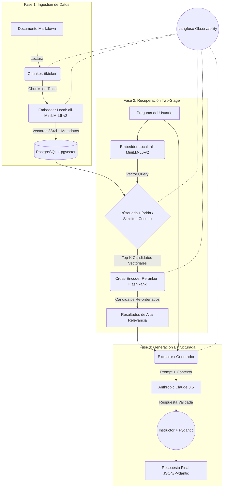

# Arquitectura Técnica del RAG Pipeline

Este documento detalla el diseño técnico, el flujo de datos y los componentes implementados hasta el momento en el proyecto **AI Engineer Sandbox**.

## Diagrama de Arquitectura del Pipeline

El siguiente diagrama muestra el flujo completo de información, desde la ingestión de documentos hasta la recuperación en dos fases y la posterior generación estructurada.

---

## Componentes Técnicos Detallados

### 1. Modelos de Datos (`src/models/`)
Utilizamos **Pydantic v2** para definir contratos estrictos en todo el pipeline:
- `SearchResult`: Define la estructura base de un candidato retornado por PostgreSQL (ID, texto, metadatos, score vectorial).
- `RerankedResult`: Hereda de `SearchResult` añadiendo el `rerank_score` generado por el Cross-Encoder.
- `StructuredAnswer` & `AnswerSource`: Modelos de salida forzada para el LLM. Obligan a la IA a proveer un puntaje de confianza, fuentes citadas y banderas booleanas (ej. `requires_more_info`).

### 2. Ingestión (`src/services/ingestion.py`)
- **Procesamiento de Texto:** Se utiliza `tiktoken` (cl100k_base) de forma determinista para realizar *chunking* de 256 tokens con un solapamiento de 30 tokens. Esto es ideal para modelos de embedding pequeños.
- **Vectorización:** Emplea `sentence-transformers` con el modelo `all-MiniLM-L6-v2` corriendo localmente en CPU/GPU para crear embeddings densos de 384 dimensiones. No requiere red ni tiene coste por token.
- **Almacenamiento:** Conexión asíncrona mediante `asyncpg` hacia **PostgreSQL 16**. Los vectores se guardan en una columna `vector(384)` provista por la extensión `pgvector`.

### 3. Recuperación Two-Stage (Retriever + Reranker)
Este es el núcleo de calidad del sistema RAG, diseñado para solventar el problema del "Lost in the Middle" y la baja precisión semántica del dot-product simple:

- **Etapa 1 - Retriever Vectorial (`src/services/retriever.py`):** 
  Busca los Top-K (ej. 5) candidatos más similares en la base de datos utilizando la distancia/similitud Coseno nativa de `pgvector` (`1 - (embedding <=> query)`). Es muy rápido, pero propenso a recuperar documentos semánticamente "cercanos" pero incorrectos en contexto.
- **Etapa 2 - Cross-Encoder Reranker (`src/services/reranker.py`):** 
  Utiliza `flashrank` con el modelo `ms-marco-TinyBERT-L-2-v2`. A diferencia del retriever que compara dos vectores previamente calculados de manera aislada (Bi-Encoder), el Cross-Encoder procesa simultáneamente la [Pregunta + Documento] a través de las capas de atención del Transformer, deduciendo si el documento *realmente responde* la pregunta. Retorna los Top-N (ej. 3) definitivos.

### 4. Extracción / Generación Estructurada (`src/services/extractor.py`)
- **Integración de Instructor:** Parchea el cliente asíncrono de `Anthropic` para forzar a Claude a escupir los resultados validando contra el esquema `StructuredAnswer` de Pydantic. Si Claude falla en el formato, `Instructor` realiza un *retry* inyectando el error de validación.
- **Prompts Delimitados:** El contexto proveniente del re-ranker se inyecta de forma clara referenciando explícitamente los UUIDs de la base de datos para garantizar el linaje de los datos.

### 5. Observabilidad Transversal (Langfuse)
Toda función principal está instrumentada con `@observe(name="...")`. Esto permite rastrear en la plataforma de Langfuse:
- El árbol completo de ejecución (Trace) de una solicitud.
- Latencias individuales del retriever vs reranker vs generación.
- Los tokens enviados al generador.

### 6. Sistema de Evaluación Automática (Evals)
La calidad del pipeline se verifica mediante pruebas unitarias en `tests/test_rag.py` usando el framework **DeepEval** y **pytest**. Bajo un enfoque *LLM-as-a-judge*, se prueban dos métricas vitales para RAG en producción:
- **Contextual Relevancy:** Evalúa de forma matemática si los documentos recuperados por el RRF y el Reranker realmente aportan contexto útil.
- **Faithfulness:** Se encarga de penalizar severamente si el generador alucina cualquier dato que no exista estrictamente dentro de las fuentes recuperadas.

