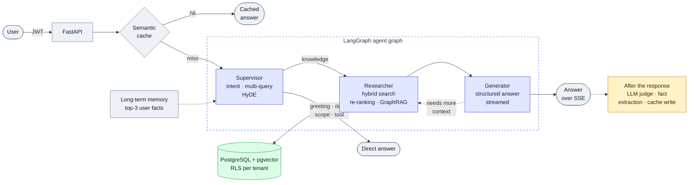

# AI Engineer Sandbox

A multi-agent RAG system built with **LangGraph**, **FastAPI** and **PostgreSQL + pgvector**: it answers questions over a document corpus, retries its own retrieval when the context falls short, isolates tenants at the database level and grades every answer with an LLM judge.


It was developed against the author's own résumé, and the supervisor prompt is written for that: questions like *"What did Bryan build at Betterfly?"* followed by *"and in which years?"*. Any Markdown, text, PDF or image file can be ingested.

> The corpus is in Spanish. The system answers in Spanish or English, in the language the supervisor decides from the question.

---

## Architecture



A request goes through these steps:

1. **Auth.** A JWT carries the tenant ID, validated as a UUID at the edge.
2. **Semantic cache.** A near-identical question from the same tenant (cosine similarity ≥ 0.85) returns the stored answer without calling the LLM.
3. **Long-term memory.** The three most relevant facts remembered about the user are added to the context.
4. **Agent graph.** A LangGraph `StateGraph` with three nodes:
   - **Supervisor** classifies the intent with Claude and a Pydantic schema. Greetings, out-of-scope questions and tool calls end here. Knowledge questions get three rewrites (multi-query) and a hypothetical answer (HyDE).
   - **Researcher** runs hybrid search for every query variant in parallel, deduplicates, re-ranks against the original question and prepends a GraphRAG subgraph when one matches.
   - **Generator** writes a structured answer with cited sources and streams it. It also flags `requires_more_info` when the context was not enough.
5. **Self-correction loop.** If the generator flags missing context, the graph sends the question back to the researcher with a wider retrieval window. It does so at most once, and not at all when a wider search cannot return anything new.
6. **Background tasks.** An LLM judge scores the answer, new facts about the user are stored, and good answers are cached.

## Key design decisions

**Hybrid retrieval with Reciprocal Rank Fusion.** One SQL query runs a pgvector HNSW search and a Spanish full-text search (`tsvector` + `ts_rank`) and fuses them with RRF (k = 60). Small embedding models miss acronyms and proper nouns that full-text catches. RRF uses ranks, not scores, so it combines cosine distance and `ts_rank` without calibrating them.

**Two-stage retrieval.** A local cross-encoder (`ms-marco-MiniLM-L-12-v2` via FlashRank) re-ranks the fused candidates. Embeddings (`all-MiniLM-L6-v2`, 384 dimensions) and the re-ranker run on CPU: no per-query cost and no documents sent to third parties.

**Bounded self-correction.** The retry widens the search (by default from 15 to 30 candidates per query variant, and from 10 to 15 documents after re-ranking) instead of repeating it. The loop stops when the corpus has no more candidates or the window has hit its cap, because a retry there would cost tokens without changing the context.

**Structured output, streamed.** Every LLM call returns a Pydantic model through Instructor, which retries with the validation error when the model's output does not fit. The generator streams `Partial[StructuredAnswer]` through LangGraph's `custom` stream channel. If the stream fails or ends before the schema is complete, it falls back to a non-streaming call.

**Tenant isolation in the database, not in the application.** No query filters by tenant by hand. PostgreSQL Row-Level Security does it on all five tables, with `FORCE ROW LEVEL SECURITY` and a least-privilege application role.

- The tenant is set per transaction with `set_config(..., true)`, so a pooled connection never leaks the previous user's tenant.
- The tenant travels with an HMAC-SHA256 signature. A `SECURITY DEFINER` function checks it against a key the application role cannot read, so even an injected SQL statement cannot switch tenants.

**Corpus language vs. question language.** Full-text search uses PostgreSQL's `spanish` configuration because the corpus is in Spanish. So the supervisor always writes its search queries and the HyDE paragraph in Spanish, whatever language the question is in. It also decides the answer language (`es` or `en`): the language of the latest question, or the one the user asks for. The generator gets that decision as an explicit order, because a long Spanish context could pull an English answer into Spanish when the model had to work the language out itself. After the answer, a deterministic detector ([lingua](https://github.com/pemistahl/lingua-py)) checks it. A mismatch never blocks or changes the answer: it is logged, kept out of the cache, and stored with the evaluation. `tests/evals/answer_language/` measures the match rate.

**Cache policy.** Only confident answers (≥ 0.5, no missing context) to knowledge questions or greetings, in the decided language, are cached. Requests with conversation history skip the cache: a follow-up like "and in which years?" means different things in different conversations.

**Online evaluation.** After each answer, a background task asks an LLM judge for faithfulness, answer relevance and context precision (0 to 1) and stores the scores, also under RLS.

## Tech stack

| Layer | Tools |
| --- | --- |
| API | FastAPI (async), Server-Sent Events, PyJWT |
| Agents | LangGraph, LangChain Core |
| LLM | Anthropic Claude Haiku 4.5, Instructor, Pydantic v2 |
| Retrieval | PostgreSQL 16, pgvector (HNSW), full-text search, asyncpg |
| Local models | sentence-transformers `all-MiniLM-L6-v2`, FlashRank cross-encoder |
| Ingestion | Semantic chunking, PyMuPDF for PDFs, Claude for image descriptions |
| Observability | Langfuse (optional) |
| UI | Streamlit |
| Tooling | uv, pytest, Docker Compose |

## Getting started

**Prerequisites:** Python 3.14, [uv](https://docs.astral.sh/uv/), Docker and an Anthropic API key.

```bash
# 1. Install dependencies
uv sync

# 2. Configure secrets (before starting the database)
cp .env.example .env
openssl rand -hex 32   # paste into TENANT_SIGNING_KEY
openssl rand -hex 32   # paste into JWT_SECRET_KEY
# then set ANTHROPIC_API_KEY, and DATABASE_URL with the app_user role

# 3. Start PostgreSQL with pgvector (schema, roles and RLS are created on first start)
docker compose up -d

# 4. Ingest a document
PYTHONPATH=. uv run python src/services/ingestion.py path/to/document.md

# 5. Run the API and the UI
PYTHONPATH=. uv run uvicorn src.api.main:app --port 8000 --reload
PYTHONPATH=. uv run streamlit run src/frontend/app.py
```

Docker Compose reads `TENANT_SIGNING_KEY` from `.env` and refuses to start without it. Keep `DATABASE_URL` on `app_user`: a superuser bypasses Row-Level Security.

The demo has two users, `bryan` and `company_x` (password `password123`), each in its own tenant.

## API

| Method | Path | Description |
| --- | --- | --- |
| `POST` | `/auth/token` | Log in and get a JWT |
| `POST` | `/chat/` | Ask a question; returns the full structured answer |
| `POST` | `/chat/stream/` | Ask a question; streams progress and the answer over SSE |
| `POST` | `/ingest/` | Upload a `.md`, `.txt`, `.pdf`, `.png` or `.jpg` file into your tenant |
| `GET` | `/health` | Health check |

## Testing

The suite has four layers:

| Layer | What it checks | Needs |
| --- | --- | --- |
| `tests/unit` | Routing, retry window, cache policy, answer language detector, tenant signature, layer purity | Nothing |
| `tests/api` | Endpoints with test doubles for the graph and services | Nothing |
| `tests/db` | Tenant isolation, role privileges and bootstrap against a disposable PostgreSQL | Docker |
| `tests/evals` | Answer quality with an LLM judge (DeepEval); being updated to the current pipeline. `answer_language/` is a separate runner, not collected by pytest ([how to run it](tests/evals/answer_language/README.md)) | API keys, `--run-evals`; the runner also needs the corpus |

```bash
uv run pytest -m "not db"   # unit + API, no Docker
uv run pytest               # also the database layer
```

## Project structure

```text
src/
├── api/                 FastAPI app, auth, chat and ingest routers
├── services/
│   ├── agent_graph/     LangGraph state, nodes, routing and graph
│   ├── retriever.py     hybrid search with RRF
│   ├── reranker.py      cross-encoder re-ranking
│   ├── router.py        supervisor: intent, multi-query, HyDE
│   ├── extractor.py     structured (and streamed) answer generation
│   ├── db.py            connection pool and signed tenant context
│   ├── cache.py, memory.py, graphrag.py, evaluator.py
│   └── ingestion.py     semantic chunking and multimodal ingestion
├── models/              Pydantic schemas
└── frontend/app.py      Streamlit UI
sql/                     schema, roles, RLS policies and migrations
tests/                   unit, api, db and evals layers
```

## Known limitations

- **Runs locally.** There is no cloud deployment yet.
- **Demo authentication.** Users live in code with plain-text passwords. The project demonstrates data isolation, not identity management.
- **No fixed evaluation set.** The online judge scores every answer, but there is no golden set of questions and expected answers to compare versions. The judge is the same model family that generates the answers.
- **Basic GraphRAG.** Subgraphs are retrieved by keyword match on entity names, without multi-hop traversal.
- **Filtered HNSW.** Row-Level Security filters after the index scan, so a tenant with few nearby documents can get fewer than *k* results.
- **SSE payloads.** Each event carries the accumulated answer, not just the new text.

## Roadmap

- Deploy on AWS (ECS Fargate + RDS) with infrastructure as code.
- A golden evaluation set wired into the offline evals.
- CI with lint and the unit and API test layers.

## Further reading

- [Technical audit](docs/TECHNICAL_AUDIT.md): every finding found while checking the docs against the code, with its fix and how it was verified.

## License

[MIT](LICENSE)

---

Built by **Bryan Bobadilla** · [bbobadilla.dev](https://bbobadilla.dev) · [LinkedIn](https://www.linkedin.com/in/bbobadillapisero)
