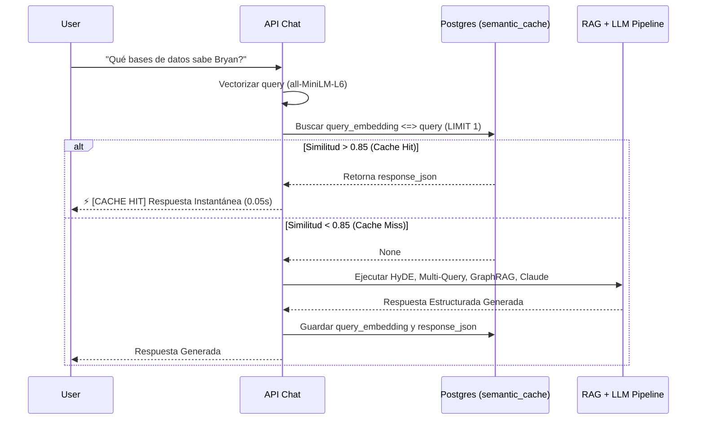
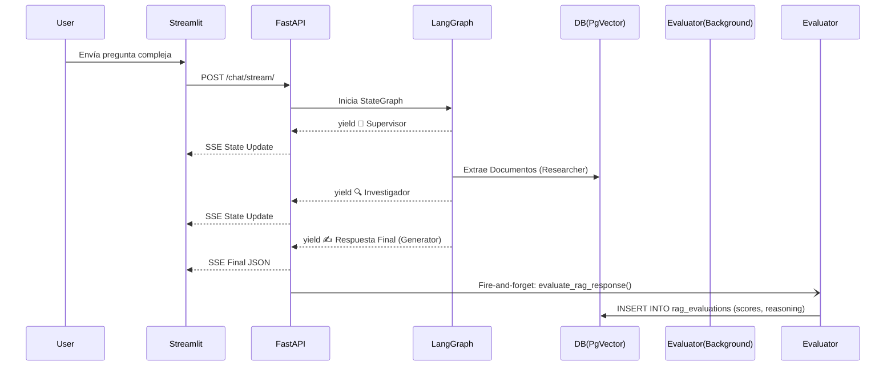

# Fase 4: Detalles de Implementación (Nivel Experto)

Este documento detalla la arquitectura implementada para dos de los componentes más avanzados del AI Engineer Sandbox: **Caché Semántico** y **Memoria Dinámica a Largo Plazo**.

---

## 1. Caché Semántico (Semantic Cache)

### 📌 El Problema
Las inferencias a LLMs (Claude) y la generación de vectores para Retrieval (RAG) tienen un costo computacional y financiero. Si los usuarios hacen preguntas idénticas o semánticamente muy similares con frecuencia, volver a ejecutar todo el pipeline es un desperdicio.

### ⚙️ Arquitectura Implementada
Se implementó una base de datos vectorial de caché en PostgreSQL (`semantic_cache`). Antes de procesar la intención de un usuario, el sistema vectoriza la pregunta y busca una coincidencia con `cosine_similarity > 0.85`.



### Decisión de Diseño:
- **Umbral de Similitud (0.85):** Para el modelo local `all-MiniLM-L6-v2` de 384 dimensiones, variaciones de fraseo (ej. "¿Qué tecnologías usa?" vs "¿Qué usa?") bajan la similitud a ~0.88. Un umbral de 0.85 demostró ser el *sweet spot* entre atrapar paráfrasis válidas y evitar falsos positivos.

---

## 2. Memoria a Largo Plazo (Long-Term Memory)

### 📌 El Problema
Los sistemas conversacionales típicos sufren de "amnesia". Solo recuerdan el contexto de la ventana actual (Chat History). Si el usuario limpia la sesión o cambia de día, el agente olvida sus preferencias, nombre o contexto laboral. 

### ⚙️ Arquitectura Implementada
Se implementó un patrón de "Extracción de Hechos en Background". El sistema analiza cada mensaje, extrae entidades/preferencias persistentes, y las guarda en el Vector Store (`user_memory`). Luego, al recibir una nueva pregunta, el bot inyecta el perfil semántico del usuario antes de contestar.

```mermaid
flowchart TD
    Q[Mensaje del Usuario] --> Router[API FastAPI]
    
    %% Flujo de Respuesta (Síncrono)
    Router --> RetrieveMemory[Recuperar Hechos (Vector Search)]
    RetrieveMemory --> DB[(Postgres user_memory)]
    DB --> |Top 3 Hechos > 0.3 Similitud| Profile[Perfil Semántico XML]
    Profile --> LLM[Claude: generate_answer]
    LLM --> Stream[Retornar Respuesta al Usuario]
    
    %% Flujo de Extracción (Asíncrono en Background)
    Router -.-> |BackgroundTasks| Extractor[Memory Extractor]
    Extractor --> Haiku[Claude Haiku (Instructor)]
    Haiku --> |Extrae: Pydantic ExtractedFacts| Vec[Vectorizar Hechos Nuevos]
    Vec --> InsertDB[(Insert Postgres user_memory)]

    classDef bg fill:#f9f,stroke:#333,stroke-width:2px;
    class Extractor,Haiku,Vec,InsertDB bg;
```

### Componentes Clave:
1. **Extracción Silenciosa (`extract_and_save_facts`):**
   Utilizando `fastapi.BackgroundTasks`, el análisis de extracción se dispara en un thread paralelo que *no bloquea* la respuesta del usuario. Si la llamada a Anthropic para extraer la memoria toma 1 segundo, el usuario jamás lo nota.
2. **Representación de Hechos (Facts):**
   A Claude se le pide estandarizar la memoria en tercera persona (ej. *"El usuario odia Java"*).
3. **Inyección Dinámica de Perfil (`retrieve_user_facts`):**
   No inyectamos **toda** la memoria en cada turno, ya que contaminaría el context-window a lo largo de los años. Hacemos una búsqueda vectorial entre la **pregunta actual y la tabla de memoria** para traer solo los 3 Hechos que sean relevantes a la conversación en curso, encapsulándolos en un tag `<USER_PROFILE>`.

## Observabilidad Activa (RAG Evaluator)

Se implementó un patrón **LLM-as-a-judge** inspirado en **RAGAS/TruLens**. Para no bloquear al usuario ni impactar la latencia de la aplicación, el evaluador se dispara como un `BackgroundTask` en FastAPI una vez que la respuesta fue enviada al cliente mediante SSE.

Se encarga de inyectar en un modelo estructurado (vía `instructor`) la Pregunta original, el Contexto recuperado por los Agentes, y la Respuesta generada. 
El LLM asigna puntajes flotantes (0.0 a 1.0) para tres métricas fundamentales:
1. **Faithfulness (Fidelidad):** Mide alucinaciones. Penaliza si la respuesta menciona información ausente en el contexto.
2. **Answer Relevance:** Mide si la respuesta ataca directamente el intent del usuario.
3. **Context Precision:** Mide la calidad del `retriever`, evaluando si el contexto inyectado realmente contenía la información útil sin "basura".

Estos datos (junto con una breve cadena de razonamiento) se almacenan en la tabla PostgreSQL `rag_evaluations` aislada bajo políticas RLS por cada Tenant.

### Flujo de Ejecución (LangGraph + Evaluador)

