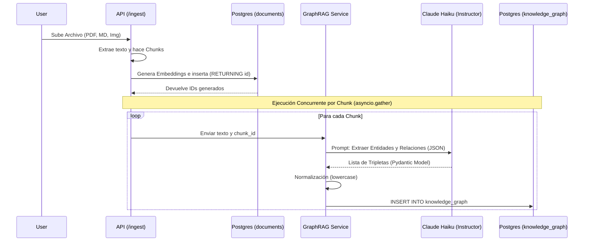

# GraphRAG Architecture Document

## Visión General
Se implementó un motor básico pero muy poderoso de **GraphRAG (Grafos de Conocimiento RAG)** apoyado sobre PostgreSQL. En lugar de utilizar una base de datos de grafos dedicada como Neo4j, aprovechamos la robustez relacional de Postgres para almacenar tripletas (nodos y relaciones) conectadas por claves foráneas a los chunks vectoriales, operando bajo el mismo motor de seguridad Multi-Tenant (RLS).

Esta estrategia permite que el LLM no solo busque fragmentos de texto semánticamente similares (Vector Search) o coincidencias de palabras clave (BM25), sino que reciba un **Contexto Estructural** explícito de cómo se relacionan las entidades mencionadas en la pregunta.

---

## 1. Esquema de Base de Datos (PostgreSQL)

Se creó la tabla `knowledge_graph` diseñada para almacenar las tripletas generadas:

```sql
CREATE TABLE knowledge_graph (
    id UUID PRIMARY KEY DEFAULT gen_random_uuid(),
    tenant_id UUID NOT NULL DEFAULT '00000000-0000-0000-0000-000000000000',
    source_node VARCHAR(255) NOT NULL,
    relation VARCHAR(255) NOT NULL,
    target_node VARCHAR(255) NOT NULL,
    source_chunk_id UUID REFERENCES documents(id) ON DELETE CASCADE
);

-- Índices B-Tree para búsquedas ultra rápidas de entidades
CREATE INDEX kg_source_idx ON knowledge_graph(source_node);
CREATE INDEX kg_target_idx ON knowledge_graph(target_node);

-- Aislamiento de Seguridad (Row-Level Security)
ALTER TABLE knowledge_graph ENABLE ROW LEVEL SECURITY;
CREATE POLICY kg_tenant_isolation_policy ON knowledge_graph 
    USING (tenant_id = NULLIF(current_setting('app.current_tenant', TRUE), '')::UUID);
```

### Decisiones de Diseño:
- **`source_chunk_id`**: Traza la procedencia exacta de la tripleta hacia el fragmento de texto original (`documents.id`). Permite borrados en cascada (`ON DELETE CASCADE`), por lo que al borrar un documento se limpia automáticamente el grafo asociado.
- **Multi-Tenancy**: Al igual que `documents`, las tripletas quedan invisibles entre tenants (usuarios) mediante RLS.

---

## 2. Flujo de Ingestión (LLM-as-a-Judge)

Cuando un archivo ingresa al sistema, el procesamiento de GraphRAG ocurre de forma **asíncrona y paralela** a la vectorización.



### Componentes Clave (`src/services/graphrag.py`):
- Usamos `instructor` para forzar a Claude a retornar un esquema estricto Pydantic:
```python
class Triplet(BaseModel):
    source_node: str
    relation: str
    target_node: str

class KnowledgeGraphExtraction(BaseModel):
    triplets: List[Triplet]
```

---

## 3. Flujo de Recuperación (Retrieval & Generation)

Al momento de responder una consulta, GraphRAG interviene inyectando relaciones explícitas antes de que se genere la respuesta.

```mermaid
flowchart TD
    Q[Pregunta del Usuario] --> Router[Agentic Router]
    
    Router -->|Query| VSearch[Hybrid Search\npgvector + FTS BM25]
    Router -->|Keywords| GSearch[Sub-Graph Search\nILIKE en Nodos]
    
    VSearch -->|Top 15 Chunks| Reranker[FlashRank\nCross-Encoder]
    Reranker -->|Top 5 Chunks| ContextPool{Pool de Contexto}
    
    GSearch -->|Tripletas coincidentes| Formatter[Formateo Estructural]
    Formatter -->|Contexto GraphRAG| Inyector[Inyección Forzada (Index 0)]
    
    Inyector --> ContextPool
    
    ContextPool --> LLM[Claude Haiku]
    LLM --> Answer[Respuesta Generada (SSE Stream)]
```

### Detalles de Implementación (`src/api/routers/chat.py` & `src/services/graphrag.py`):
1. **Extracción Simple de Nodos**: Para evitar latencia usando un LLM en tiempo real, extraemos tokens (palabras clave > 3 letras) directo de la query del usuario.
2. **Búsqueda Difusa (ILIKE)**: Buscamos en Postgres si existe alguna relación donde el nodo origen o destino contenga esa palabra clave (ej. si la pregunta es sobre "Python", busca nodos que contengan `%python%`).
3. **Inyección Blindada**: El texto resultante (`[Bryan] --(sabe)--> [Python]`) **NO pasa por el Reranker**. Se salta el modelo Cross-Encoder y se inyecta por la fuerza en la posición `0` de la lista final de resultados:
```python
if graph_context:
    best_results.insert(0, SearchResult(
        id="graphrag-subgraph",
        content=graph_context,
        metadata={"source": "GraphRAG Local Database"},
        score=1.0
    ))
```
**¿Por qué?** Porque los modelos Rerankers basados en BERT están entrenados para puntuar prosa natural. Suelen penalizar textos altamente estructurados y sintéticos (como listas de tripletas), dándoles un score bajo y descartándolos. Al inyectarlo *después* del Reranker, garantizamos que el LLM final siempre lo lea.

---

## 4. Estructura de Archivos Modificada
* `sql/01_init.sql` (Opcionalmente `apply_graphrag.sql`): Definición de tablas DDL y Row-Level Security.
* `src/services/graphrag.py`: Contiene lógica de Extracción (LLM) y Recuperación (SQL).
* `src/services/ingestion.py`: Modificado para retornar IDs tras la inserción y orquestar las tareas asíncronas de GraphRAG usando `asyncio.gather`.
* `src/api/routers/chat.py`: Inyección del sub-grafo en el endpoint síncrono (`/chat/`) y asíncrono SSE (`/chat/stream/`).
