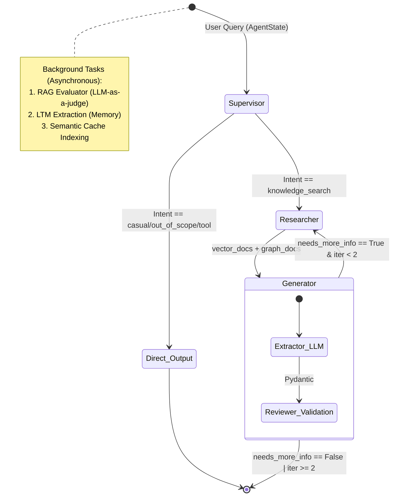

# Enterprise Multi-Agent RAG System: A State-of-the-Art Architecture for Autonomous Technical Reasoning

## 1. Abstract

Retrieval-Augmented Generation (RAG) systems have proven effective in providing Large Language Models (LLMs) with domain-specific knowledge. However, traditional implementations suffer from rigid linear routines, hallucinations due to poor retrieval, and long-term contextual amnesia. In this paper, we present the design, mathematical formalization, and implementation of an autonomous *Multi-Agent* ecosystem (AI Engineer Sandbox).

Our architecture breaks the linear paradigm by utilizing **LangGraph** to orchestrate a cyclic state graph (`StateGraph`), where specialized agents (Supervisor, Researcher, and Generator) communicate asynchronously and employ Self-Correction mechanisms when context is lacking. To maximize retrieval relevance, we implemented a *Two-Stage Retrieval* system that fuses hybrid search (Vector + BM25 via Reciprocal Rank Fusion) with a local Cross-Encoder model (FlashRank), complemented by semantic network extraction through GraphRAG.

The system solves production bottlenecks through: (a) *Semantic Chunking* guided by statistical deviations of cosine distance, (b) a Long-Term Memory and Semantic Cache stored in PostgreSQL (`pgvector`) under strict Row-Level Security (RLS) policies for Multi-Tenant architectures, and (c) an asynchronous passive evaluator (LLM-as-a-judge) inspired by RAGAS for continuous observability. Finally, the environment is deterministically typed using Pydantic v2 and Instructor, allowing the emission of complex responses in real-time (Server-Sent Events) without breaking data contracts.

---

## 2. Introduction

The rapid advancement of Large Language Models (LLMs) has shifted the research focus from purely syntactic comprehension to the creation of autonomous agents capable of reasoning over vast proprietary knowledge bases. The RAG (Retrieval-Augmented Generation) architecture quickly became the standard solution for injecting this knowledge without incurring the prohibitive costs of continuous fine-tuning.

However, the *naïve RAG* approach (where a user query is directly embedded for cosine similarity search in a vector database and passed to the LLM in a single attempt) presents profound systemic weaknesses. In production environments or highly technical engineering tasks, queries are often ambiguous or lack explicit context. Furthermore, arbitrarily fragmenting documents by character count (Fixed-size Chunking) frequently splits meaning mid-thought, and purely vector-based systems fail when attempting to retrieve long-tail keywords or highly specific jargon that does not map correctly into the latent embedding space.

To resolve these limitations, this project (AI Engineer Sandbox) proposes a mature systemic architecture geared towards Enterprise-grade production. We replace traditional sequential execution with a **Multi-Agent Ecosystem** coordinated via graph theory (LangGraph). This paradigm allows a Supervisor agent to analyze query intent, apply transformation techniques (Multi-Query and Hypothetical Document Embeddings - HyDE), and delegate search tasks to specialized routines. Should the Generator node determine that the retrieved context is statistically insufficient or ambiguous, the system is capable of halting the flow, modifying search parameters, and iterating over the database autonomously before delivering a final response to the client.

At the data infrastructure level, the project abandons isolated vector databases (such as Pinecone or Weaviate) in favor of a unified approach on **PostgreSQL 16**. By utilizing the `pgvector` extension and the hierarchical HNSW index, we unify semantic retrieval, native Full-Text Search (BM25), and structured knowledge extractions (GraphRAG) within the same database transaction. This enables the enforcement of deterministic filters via *Row-Level Security* (RLS) for Multi-Tenant SaaS architectures.

Finally, this paper details how observability is orchestrated (measuring faithfulness and precision in the background without penalizing user latency) and how software determinism is ensured through probabilistic validations with Pydantic and Instructor. The goal of this paper is to break down the implementation, mathematically justify each threshold, and expose the design trade-offs faced in building a highly autonomous virtual engineer.

---

## 3. Theoretical Framework and Related Work

The design of our architecture is founded on recent advances in Natural Language Processing (NLP) literature and distributed systems. In this section, we break down the theoretical pillars that support the algorithmic decisions of the *AI Engineer Sandbox*.

### 3.1. Retrieval-Augmented Generation (RAG)
Formally introduced by Lewis et al. (2020) [1], the RAG paradigm mitigates LLM hallucinations by conditioning text generation on dynamically retrieved external documents. Traditionally, a RAG system consists of a *Retriever* (which searches for relevant information in a corpus) and a *Generator* (which synthesizes the answer). Our project expands this concept into what the literature terms "Advanced RAG" (Gao et al., 2023) [2], incorporating pre-retrieval phases (query transformation via HyDE) and post-retrieval phases (re-ranking).

### 3.2. Multi-Agent Systems and State Orchestration
Unlike static prompt chains (e.g., sequential LangChain), multi-agent systems distribute cognitive load across specialized roles. Inspired by architectures like AutoGen (Wu et al., 2023) [3], our system utilizes a directed state graph (implemented via LangGraph). In this paradigm, communication between agents is not direct; instead, it occurs through a concurrently mutated state object (`AgentState`). Finite State Machine (FSM) theory allows the orchestrator (Supervisor) to dynamically decide execution edges (transitions) based on state preconditions, enabling *Self-Correction* loops where the system can backtrack to search for more information if the Generator sub-agent deems the context insufficient (Shinn et al., 2023, *Reflexion*) [4].

### 3.3. Hybrid Retrieval and Reciprocal Rank Fusion (RRF)
Pure semantic retrieval via Bi-Encoder models (Dense Passage Retrieval) struggles to retrieve long-tail terms, acronyms, or proper nouns, where lexical retrieval (Bag of Words / BM25) is mathematically superior (Robertson et al., 2009) [5]. The system implements Hybrid Search by combining dense vectors and lexical matches. To fuse these two disparate metric spaces (continuous cosine distance vs. discrete TF-IDF scores), we use **Reciprocal Rank Fusion (RRF)** (Cormack et al., 2009) [6]. RRF is a heuristic voting algorithm that unifies document positions without the need to train a weighting model (D-weights), calculating similarity through the inverse of the rank penalized by a constant $k$.

### 3.4. Re-ranking via Cross-Encoders
While Bi-Encoders compute query and document embeddings separately, losing deep attentional interactions (Reimers & Gurevych, 2019) [7], *Cross-Encoders* concatenate the query and document, feeding them simultaneously into the neural network (e.g., BERT). This allows the self-attention layer to cross-attend tokens from both sequences. Due to its high computational complexity $\mathcal{O}(N)$, the system adopts a *Two-Stage Retrieval* approach, using the fast Bi-Encoder to obtain a broad top-$K$ set and delegating the final precision refinement to the local Cross-Encoder (FlashRank) (Nogueira & Cho, 2019) [8].

### 3.5. GraphRAG and Knowledge Graphs
Vector RAG systems inherently fail at connecting scattered semantic entities across multiple documents (Edge et al., 2024) [9]. The **GraphRAG** technique solves this by extracting knowledge subgraphs during ingestion. By modeling the corpus as a network of nodes and edges (`Subject-Predicate-Object` triplets), the system can execute topological searches and retrieve a relationship schema (NetworkX) that provides the LLM with a global context map unattainable through pure cosine distance.

### 3.6. Tool Use (Function Calling)
The ability of LLMs to output structured tokens that match external API signatures (Function Calling) was popularized by architectures like Toolformer (Schick et al., 2023) [10]. In our implementation, the Supervisor acts as an intent classifier capable of abstracting user parameters and executing deterministic, hardcoded tools (e.g., HTTP REST API requests).

### 3.7. Long-Term Memory and Semantic Cache
To endow the system with cognitive persistence (Anti-Amnesia), an asynchronous agent is implemented to extract user profiles and facts. In turn, to mitigate latency and economic costs of repetitive calls (Token Economics), a **Semantic Cache** is used. Rather than requiring Exact Matches, the cache stores previous query vectors indexed via HNSW (Hierarchical Navigable Small World, Malkov & Yashunin, 2018) [11], intercepting semantically identical requests in constant time $\mathcal{O}(\log N)$.

### 3.8. Active Observability and LLM-as-a-judge Paradigm
Evaluating generative systems requires more complex metrics than BLEU or ROUGE. Frameworks like **RAGAS** (Es et al., 2023) [12] and TruLens propose the *LLM-as-a-judge* paradigm (Zheng et al., 2023) [13], where an evaluator LLM (judge) scores the generator LLM without needing Ground Truth (manually labeled data). Our system abstracts this framework into an asynchronous routine that calculates *Faithfulness* (hallucination degree), *Answer Relevance* (query precision), and *Context Precision* (retrieval quality), saving a continuous log for auditing without introducing latency to the end-user.

---

## 4. System Architecture

The *AI Engineer Sandbox* is designed under *Clean Architecture* principles, strictly separating the presentation layer, routing logic (API), agent orchestration, and data persistence. The system abandons synchronous, single-threaded execution and adopts an asynchronous event-driven architecture to support high traffic.

### 4.1. Overview and Tech Stack
The infrastructure is founded on a modern Python ecosystem (version 3.12+) managed via the `uv` packager.
- **Logic Layer (Backend):** Implemented in **FastAPI**, providing asynchronous routing and native WebSockets/SSE.
- **Reasoning Layer:** Orchestrated by **LangGraph** (handling cyclic graphs) and powered by **Anthropic Claude 3.5 Haiku**. *Haiku* was chosen for its ultra-low latency (ideal for the Supervisor node) and its low cost per token (Token Economics), ensuring fluid routing without sacrificing analytical capability.
- **Persistence Layer:** **PostgreSQL 16** with the **pgvector** extension. It centralizes semantic vectors, the lexical search engine (BM25), semantic cache, relational memory schemas, and the knowledge graph store, bypassing the need to maintain isolated database microservices.
- **Presentation Layer:** **Streamlit**, operating as a decoupled client that consumes server events in real-time.

### 4.2. Graph Topology and Shared State
The reasoning flow is not a sequential pipeline, but a Directed Finite State Machine (FSM). Components (Nodes) do not pass variables directly to each other; instead, they mutate a globally shared state (`AgentState`).



The `AgentState` is implemented as a `TypedDict` in Python that traverses all nodes, carrying mutable properties such as the original query, user tenant ID, history, search variations, retrieved documents, a completeness flag (`needs_more_info`), and an iterations counter (`iterations`) to prevent infinite loops.

### 4.3. Graph Nodes and Agent Ecosystem

The system architecturally distinguishes between *Nodes* (functions executing deterministic logic within the graph) and *Agents* (non-deterministic LLM calls with a system prompt).

#### 4.3.1. Supervisor Node (`supervisor_node`)
- **Role:** Acts as a semantic router, intent classifier, and tool injector. Defines whether the request should be resolved locally or hit the database.
- **Invoked LLM Agent:** `analyze_query` (`src/services/router.py`).
- **Inputs:** Original `query` and `history`.
- **Outputs:** Mutates the `AgentState` by injecting `intent_type` and `search_queries`.
- **System Prompt:** *"You are the 'Router' of an AI Engineer Sandbox... Determine the intent (casual_greeting, knowledge_search, tool_execution, out_of_scope)... Generate 3 query variations optimized for vector search (Multi-Query)... Write a hypothetical_document (HyDE)..."*
- **Assigned Tools (Tool Use):** `get_current_time`, `get_crypto_price`, `get_github_profile`. If a tool intent is detected, the Node halts the flow, invokes the Python function (`src/services/tools.py`), and inserts the direct result into the state.

#### 4.3.2. Researcher Node (`researcher_node`)
- **Role:** Strictly a **pragmatic node**. It consumes no LLM tokens. Acts as the asynchronous I/O engine interacting with the database.
- **Invoked LLM Agent:** None.
- **Execution Logic:** Receives queries (Original Query, Multi-Query Variations, HyDE Document) and fires concurrent SQL queries using `asyncio.gather`. Deduplicates results using Python Hashing Sets, passes the clean list through the local Re-ranker (FlashRank), and attaches the GraphRAG sub-graph. On each retry it widens the retrieval window (`retrieval_window`): it multiplies the candidates per variant and lets 50% more documents through the re-ranking, capped at the API maximums. It sets `retrieval_exhausted` when widening could not bring anything new. Finally, increments `iterations += 1`.

#### 4.3.3. Generator Node (`generator_node`)
- **Role:** Final synthesizer and logical Reviewer. Compiles the final response for the user and evaluates if it has enough context to answer without hallucinating.
- **Invoked LLM Agent:** `generate_answer` (`src/services/extractor.py`).
- **System Prompt:** *"You are an expert answering questions strictly based on the retrieved context... Use [Doc X] to cite. User context: {user_profile}..."*
- **Termination / Routing Condition:** The model outputs the `StructuredAnswer` Pydantic structure, which contains a boolean flag `requires_more_info`. The node maps this flag to the state as `needs_more_info`. The edge interceptor function (`route_reviewer`) reads this value; if `True`, `iterations` is less than 2, and the search can still be widened (`retrieval_exhausted` is `False`), the flow *returns* to the Researcher (Self-Correction); otherwise, it transitions to `END`.

#### 4.3.4. Asynchronous Agents (Background Tasks)
To avoid blocking the FastAPI event loop (and thus penalizing the latency perceived by the end user), the system delegates heavy workloads to asynchronous "fire-and-forget" tasks.
1. **Evaluator Agent (`evaluate_rag_response`):** An LLM-as-a-judge invoked with the prompt: *"You are an impartial judge evaluating a RAG system. Your job is to evaluate 3 metrics from 0.0 to 1.0 (Faithfulness, Answer Relevance, Context Precision)..."*.
2. **Memory Agent (`extract_and_save_facts`):** Invokes a background LLM with the prompt: *"You are an assistant that extracts useful facts or user preferences... Write them in third person, short sentences."*. The results are vectorized and saved to be permanently injected into future responses via the Generator's `{user_profile}` field.
3. **GraphRAG Extraction Agent (`extract_knowledge_graph`):** Operates exclusively during the document ingestion route (`/ingest/`), using the prompt *"You are a GraphRAG expert. Extract a knowledge graph... Return triplets (SOURCE NODE, RELATION, TARGET NODE)."*.

### 4.4. Presentation Layer and Multi-Tenant Isolation
Communication between the Streamlit UI and FastAPI utilizes the **Server-Sent Events (SSE)** protocol. This allows generating a data stream token by token, producing instant feedback on the interface, mitigating the Time-To-First-Token (TTFT) issue in massive responses.

To scale the system to Enterprise SaaS level, the database is not globally shared. **JWT** authentication injected into HTTP Bearer headers is utilized. At the database level, instead of filtering with `WHERE tenant_id = X` statements (which are susceptible to human error or SQL Injection), strict **Row-Level Security (RLS)** policies are enabled in PostgreSQL. Upon opening the connection pool, the backend injects `SET app.current_tenant = X`, forcing the database to physically hide any document, memory, or history row that does not belong to the authenticated session.


---

## 5. Mathematical Formalization

This section rigorously defines the mathematical models, numerical algorithms, and empirical parameters that govern the deterministic behavior of the system.

### 5.1. Hybrid Search and Reciprocal Rank Fusion (RRF)
The *retriever* system addresses the retrieval problem by combining two disparate metric spaces: continuous dense similarity and discrete lexical relevance scoring.

Let $D = \{d_1, d_2, \dots, d_N\}$ be the corpus of partitioned documents in the database.
Given a query $q$, we define two ranking functions:
1. **Vector Ranking ($R_v$):** Orders documents ascendingly according to the cosine distance between the query vector $\mathbf{v}_q \in \mathbb{R}^{384}$ and the document embedding $\mathbf{v}_d \in \mathbb{R}^{384}$.
2. **Lexical Ranking ($R_f$):** Orders documents descendingly using the native `ts_rank` PostgreSQL metric (an implementation of BM25 / Term Frequency-Inverse Document Frequency weighting).

To fuse both classifications into a unified score $S_{RRF}(d)$, the Reciprocal Rank Fusion formula is used (implemented in `src/services/retriever.py`, lines 33-34):

$$ S_{RRF}(d) = \frac{1}{k + R_v(d)} + \frac{1}{k + R_f(d)} $$

Where:
- $R_v(d)$ and $R_f(d)$ represent the positional rank (1, 2, 3...) of document $d$ in their respective lists. If a document does not appear in a list, its term in the sum collapses to $0$.
- $k \in \mathbb{Z}^+$ is an empirical smoothing constant. The system uses the industry standard $k = 60$ to prevent extremely high positions in a single method from disproportionately dominating the combined score.

At inference time, individual lists are filtered with $top\_k = 15$ before fusion.

### 5.2. Text Segmentation (Semantic Chunking) via Statistical Analysis
To partition documents during ingestion, fixed-size chunking is abandoned in favor of calculating semantic transition boundaries. Given a document broken down sequentially into sentences $S = \{s_1, s_2, \dots, s_M\}$, they are projected into the latent space as $\mathbf{e}_i \in \mathbb{R}^{384}$.

The discrete cosine similarity between adjacent sentences is computed (`src/services/ingestion.py`, lines 18-20):

$$ \text{Dist}(\mathbf{e}_i, \mathbf{e}_{i+1}) = 1 - \frac{\mathbf{e}_i \cdot \mathbf{e}_{i+1}}{\|\mathbf{e}_i\| \|\mathbf{e}_{i+1}\|} $$

To dynamically determine if two sentences belong to the same context, the breaking threshold $\tau$ is calculated using the population statistics of the entire document's distances (Line 23):

$$ \tau = \mu_{\text{Dist}} + c \cdot \sigma_{\text{Dist}} $$

Where $\mu_{\text{Dist}}$ is the sample mean, $\sigma_{\text{Dist}}$ is the standard deviation, and $c$ is an empirical multiplier fixed at $1.25$. A new partition (Chunk) is generated if, and only if, $\text{Dist}(\mathbf{e}_{i-1}, \mathbf{e}_i) > \tau$, or if the accumulated token count of the current chunk exceeds the strict upper limit $L_{max} = 500$ tokens (Line 26).

### 5.3. Vector Spaces, Semantic Cache, and HNSW Indices
For both the main database and the **Semantic Cache** table, the `pgvector` extension in PostgreSQL is employed (`sql/01_init.sql`).
Metrics in $\mathbb{R}^{384}$ are optimized using the *Hierarchical Navigable Small World* (HNSW) graph index. Since the vectors originate from the `all-MiniLM-L6-v2` model which yields already normalized vectors ($\|v\| = 1$), the `vector_cosine_ops` index operator efficiently degrades to a simple dot product subtraction.

The HNSW index inherits pgvector's default parameters:
- $m = 16$: Maximum number of bi-directional links created for every new element during insertion.
- $ef\_construction = 64$: Size of the dynamic candidate list during insertion.

For interception (Cache Hit), the system (`src/services/cache.py`) evaluates if there is a previous query $\mathbf{v}_{prev}$ whose similarity to the current query $\mathbf{v}_{curr}$ satisfies:

$$ (1 - \text{Dist}_{\text{cos}}(\mathbf{v}_{prev}, \mathbf{v}_{curr})) \geq 0.85 $$

### 5.4. StateGraph Formalization (Finite State Machine)
Orchestration is abstracted as a Directed Finite State Machine $\mathcal{M} = \langle \Sigma, S, s_0, \delta, F \rangle$ (`src/services/agent_graph/graph.py`), where:
- **States ($S$):** $\{Sup, Res, Gen, End\}$ corresponding to the Supervisor, Researcher, Generator nodes, and the terminal output state.
- **Initial State ($s_0$):** $Sup$.
- **Transition Alphabet ($\Sigma$):** Flags injected into the mutated memory object (e.g., $intent\_type$, $requires\_more\_info$, $iterations$).
- **Accepting States ($F$):** $\{End\}$.

The conditional transition function $\delta(s, \sigma) \to s'$ in the review router ($Gen \to ?$ at Line 10) is rigidly defined by:
$$ 
\delta(Gen) = \begin{cases} 
Res, & \text{if } requires\_more\_info = \text{True } \land \text{ } iter < 2 \\ 
End, & \text{otherwise} 
\end{cases} 
$$
This ensures a Strict Loop Complexity of $\mathcal{O}(2)$, preventing infinite *Self-Correction* cycles and impacting the asymptotic predictability of computational and LLM inference costs.

### 5.5. Multi-Query Fusion, Deduplication, and Complexity
In the *Agentic* flow, the Researcher node (`src/services/agent_graph/nodes.py`) receives a set $Q = \{q_{orig}, q_{var1}, q_{var2}, q_{var3}, q_{hyde}\}$. The function triggers asynchronous concurrent processes for each query, collapsing the results into a subset $C_{multi}$. 
Final deduplication $C_{unique}$ is achieved through membership evaluation on unequivocal Python Hash sets:
$$ C_{unique} = \bigcup_{i=1}^{|Q|} \{ d \in \text{Retrieve}(q_i) \mid Hash(d.content) \notin \text{SeenSet} \} $$
The total time complexity of this distributed retrieval is reduced to $\mathcal{O}(\max_{q_i} T_{retrieval}(q_i))$ thanks to parallel coroutine dispatch (`asyncio.gather`), bounded by the latency of the `asyncpg` connection pool.

The GraphRAG knowledge string is prepended (`.insert(0)`) to this set. The naive **GraphRAG** engine (`src/services/graphrag.py`) extracts fuzzy seeds looking for static Regex roots `\w+` ($len>3$) and performs a flat 1-hop relational interpolation ($limit = 10$).

### 5.6. Formal Definition of Evaluator Metrics (LLM-as-a-judge)
The system implements continuous probabilistic passive evaluation mapped into a continuous domain (`CHECK` constraints on the `rag_evaluations` table in `sql/01_init.sql`) via the evaluating function (`src/services/evaluator.py`). 
The LLM judges the trace by assigning normalized scores:
- $Score \in [0.0, 1.0]$.
Where the mathematical model breaks down into the three core Ragas metrics:
1. **Faithfulness ($f$):** Ratio of generated facts in the response versus those strictly derivable from the provided context.
2. **Answer Relevance ($r$):** Cosine discrepancy or semantic deduction between the final generated response and the actual underlying question.
3. **Context Precision ($p$):** Signal-to-noise ratio evaluating whether the extracted fragments provided true useful knowledge rather than filler text from adjacent chunks.
The Pydantic constraints `ge=0.0` and `le=1.0` forcefully reject any LLM response outside the probabilistic support, throwing a `ValidationError` that guarantees the stability of the auditing metric system.

---

## 6. Design and Implementation

To translate theoretical foundations and abstract formulations into a highly concurrent production system, the *AI Engineer Sandbox* was designed with extreme attention to memory management, error handling, and code modularity.

### 6.1. Repository Structure and Separation of Concerns
The project respects the topology of *Clean Architecture*.
- **Configurations:** `pyproject.toml` (dependency management via `uv`), `.env`, and the persistence deployment file `docker-compose.yml`.
- **`sql/`**: Maintains DDL initialization scripts (`00_create_app_user.sql`, `01_init.sql`) and, under `sql/migrations/`, iterative migrations for HNSW and Row-Level Security (`apply_rls.sql`, `apply_cache.sql`, etc.).
- **`src/api/`**: The REST presentation layer. `main.py` boots the asynchronous FastAPI server and configures CORS middlewares. `auth.py` contains JWT decoding logic. The `routers/` folder exposes HTTP entry ports (`chat.py` and `ingest.py`), completely separating URLs from underlying business logic.
- **`src/models/`**: Defines application contracts using Pydantic v2 validation (e.g., `structured.py`, `search.py`, and `requests.py`). 
- **`src/services/`**: Houses the algorithmic guts of the RAG. `ingestion.py`, `retriever.py`, `reranker.py`, `extractor.py`, `cache.py`, `graphrag.py`, and `evaluator.py`. Function Calling tools reside in `tools.py`.
- **`src/services/agent_graph/`**: The Multi-Agent ecosystem with `graph.py` assembling the StateGraph, `nodes.py` implementing the actuators, and `state.py` defining the in-memory graph.
- **`src/frontend/app.py`**: The Streamlit client for visual real-time prototyping.

### 6.2. Concurrency and Persistence (asyncpg and Row-Level Security)
FastAPI is built on Python's *Event Loop*. To ensure the database does not cause Thread-Blocking on the main thread, the system does not use classic ORMs (synchronous SQLAlchemy) but rather employs `asyncpg` to open pure asynchronous connection pools, crucial during simultaneous execution of Multi-Query in the researcher node.

Multi-Tenant security is entirely delegated to the PostgreSQL engine via **Row-Level Security (RLS)**. When a valid JWT is decoded (`src/api/auth.py`), the asynchronous pool is intercepted and injected into the transactional header (`SET app.current_tenant = X`). For example, in `src/services/retriever.py`, even if an attacker achieved *Prompt Injection* to extract foreign information, the database would natively truncate any vector result that does not match the current RLS context of the connection.

### 6.3. Token Management and Strict Contracts (Instructor + Pydantic v2)
Forcing a massive LLM to return valid and manageable JSON objects traditionally requires complex heuristic retry schemas. The system sidesteps this problem by using **Instructor**, an idiomatic patch around Anthropic calls that ensures strict typing via `Pydantic v2`.

Critical fragment in `src/services/router.py`:
```python
class QueryIntent(BaseModel):
    intent_type: str = Field(description="Must be 'casual_greeting', 'knowledge_search'...")
    search_queries: list[str] = Field(description="Generates 3 search variations")
    hypothetical_document: str = Field(description="Hypothetical paragraph (HyDE)")
    tool_name: str = Field(default="")

response = await client.messages.create(
    model="claude-haiku-4-5-20251001",
    max_tokens=500,
    messages=[{"role": "user", "content": prompt}],
    response_model=QueryIntent,
)
```
Instructor injects a strict *schema parser* and forces the LLM to instantiate the `QueryIntent` class. This completely eradicates structural parsing failures and dreaded *KeyErrors* in subsequent code logic.

### 6.4. Two-Stage Retrieval Design (Cross-Encoder)
The *Re-ranking* implementation occurs in `src/services/reranker.py`. Unlike external Re-ranking APIs like Cohere, our solution employs a local static library, **FlashRank**, with the `ms-marco-MiniLM-L-12-v2` model running purely in the server's RAM. This model receives the concatenated tuple $(Query, Vector\_Context)$ and interleaves tokens to find cross-attention, drastically mitigating the syntactic false positive retrieval problem generated by BM25.

### 6.5. Tool Invocation (Function Calling)
Intent logic physically materializes in the `supervisor_node` (`src/services/agent_graph/nodes.py`). If the Pydantic instance generated by the Supervisor marks `intent_type == "tool_execution"`, the node halts any vector routing. It reads `tool_name` from the JSON, dynamically extracts the function from the Python dictionary `TOOLS_REGISTRY` (housed in `src/services/tools.py`) passing the `**intent.tool_args` parameters, and pushes a new state to the graph with the raw response from the external API (e.g., *HTTP request* to the GitHub API). To mitigate risks and UI *hanging*, underlying libraries operate with explicit `timeout=5` interruption clauses.

---

## 7. End-to-End Execution Flow

To truly understand the architectural synergy of the aforementioned nodes and subroutines, this section analytically traces the lifecycle of a complete query (e.g., *"What Cloud and Backend technologies does the candidate have experience with, and how do they relate to each other?"*).

### 7.1. General Sequence Diagram

```mermaid
sequenceDiagram
    autonumber
    actor U as User
    participant UI as Streamlit UI
    participant API as FastAPI Router
    participant Sup as Supervisor Node
    participant Inv as Researcher Node
    participant Gen as Generator Node
    participant BD as PostgreSQL (PgVector)
    participant BG as Background Tasks
    
    U->>UI: Inputs complex query
    UI->>API: HTTP POST /chat/stream/ (JWT)
    API->>API: Authentication and Tenant ID Extraction
    API->>BD: Check Semantic Cache (Similarity > 0.85)
    alt Cache Hit
        BD-->>API: Cached Response
        API-->>UI: Instant SSE
    else Cache Miss
        API->>Sup: Initializes AgentState
        Sup->>Sup: LLM: Analyzes Intent, generates HyDE and Multi-Query
        Sup->>Inv: Conditional Transition (knowledge_search)
        
        rect rgb(40, 44, 52)
            note right of Inv: Self-Correction Loop (Max Iter: 2)
            Inv->>BD: Concurrent: Vector Search + BM25 (RRF)
            Inv->>BD: Concurrent: GraphRAG Extraction (1-hop)
            Inv->>Inv: Set Deduplication + Re-ranking (FlashRank)
            Inv->>Gen: Transition (vector_docs + graph_text)
            Gen->>Gen: LLM: Attempts to Generate Pydantic Response
            
            alt needs_more_info == True & iter < 2
                Gen-->>Inv: Routing: Review fails, returns to Researcher
                Inv->>Inv: Iterations += 1 (Re-execution with expanded state)
                Inv->>Gen: Transition
            end
        end
        
        Gen->>Gen: Final Response Generated Successfully
        Gen->>API: AgentState["final_answer"]
        API-->>UI: Returns Response (Streaming SSE)
        API->>BG: Fires asynchronous Fire-and-forget tasks
        BG->>BD: Evaluates LLM-as-a-judge (RAGAS-style)
        BG->>BD: Extracts LTM and saves to Semantic Cache
    end
```



### 7.2. Step-by-Step State Trace (AgentState)

1. **Ingress and Authentication:** The `Streamlit` application launches an HTTP request to the `src/api/routers/chat.py` *endpoint*. The middleware intercepts the header, verifies the cryptographic symmetry of the JWT token (`src/api/auth.py`), extracts the `tenant_id` UUID, and couples it to the initial `AgentState` block.

2. **Cache Layer Interception ($\mathcal{O}(0)$ LLM Cost):** Before invoking the LangGraph topology, the system extracts the current query's *Embedding*. A relational crossover is performed against the `semantic_cache` table. If the cosine distance yields a similarity $\geq 0.85$, the engine completely interrupts orchestration and returns the stored JSON with $0$ Anthropic inference latency. Let us assume a *Cache Miss* for this flow.

3. **Supervisor Node Invocation:** 
   - *Receives:* `AgentState = {"query": "...", "tenant_id": "...", "iterations": 0}`
   - *Processes:* Via Instructor, asks Claude Haiku to classify the request. The model dictates `intent_type = "knowledge_search"`. Proceeds to generate $3$ synonymous permutations and a fictional perfect response paragraph (HyDE).
   - *Mutates State:* Adds the variations list to the `search_queries` field.
   - *Routing:* The `route_supervisor` conditional function inspects the state and transitions control to the Researcher.

4. **Researcher Node Invocation (Iteration 1):** 
   - *Receives:* `AgentState` with the $4$ variations (Multi-Query + HyDE).
   - *Processes:* Opens `asyncpg` connections, applies the local `SET app.current_tenant` filter to comply with RLS, and dispatches parallel `asyncio.gather` coroutines retrieving chunks via Reciprocal Rank Fusion ($k=60$) and fuzzy semantic network graph triplets. The system merges the lists, implements Python *Hashing* eliminating identical text duplicates, and reduces the semantic load by passing the clean set through the Cross-Encoder (FlashRank), fixing a final limit of the best 10 chunks.
   - *Mutates State:* Inserts documents into `documents` and mathematically increments the counter: `iterations = 1`.
   - *Routing:* Fixed edge to Generator.

5. **Generator Node Invocation and Self-Correction (Iteration 2):**
   - *Receives:* The dense `AgentState`. Additionally, the node passively invokes long-term memory (LTM) to inject historical preferences into the Template variables block (Prompt Template).
   - *Processes:* Logic asks the LLM to draft the structure. The LLM detects that the retrieved lexical context fails to deeply explain "the relationship" between Cloud and Backend, and thus asserts `requires_more_info = True`.
   - *Routing:* The `route_reviewer` interceptor function detects the enabled flag. Since `iterations` ($1$) is less than the maximum limit ($2$), the transition function dictates `return "researcher"`. The loop physically backtracks in the graph. 

6. **Final Generation and Streaming SSE:** The Researcher Node repeats the cycle and delivers fresh state back to the Generator Node (`iterations = 2`). After reprocessing, the model successfully compiles the structure (flag to `False`). The Markdown response generated with `[Doc X]` citations is assigned to the `final_answer` key. The graph halts, and the FastAPI *router* encapsulates the text block in Server-Sent Events, gradually dispatching it to the *Frontend*.

7. **Background Processes (Asynchronous):** The user has already received the complete visualization of their response. However, the Uvicorn server does not kill the *request*. FastAPI built-in *Background Tasks* are fired:
   - The final query and response are vectorized and saved to the database (Semantic Cache).
   - The massive **Passive Evaluator (LLM-as-a-judge)** process runs, investing computational time to mathematically measure the *Faithfulness* and *Precision* of the just-completed process, archiving the metrics in the `rag_evaluations` table for administrative auditing.

---

## 8. Evaluation and Active Observability

Measuring the effectiveness of a complex generative system, whose outputs are non-deterministic (in terms of exact character concatenation), is one of the greatest challenges in *AI Engineering*. The Sandbox architecture early on abandoned human empirical gathering (A/B Testing in the Streamlit view) to adopt an automatic framework in the deep cloud.

### 8.1. LLM-as-a-judge Implementation (RAGAS Style)
Instead of relying on synchronous testing *scripts*, the system introduced a Continuous Passive Evaluation paradigm. A dedicated agent was developed in `src/services/evaluator.py` that asynchronously receives (via FastAPI's `BackgroundTask`) the fundamental triad: (1) The user's original query, (2) the set of text fragments retrieved from the hybrid search engine, and (3) the final response emitted by the Generator node.

Inspired by the RAGAS (Retrieval Augmented Generation Assessment) framework, this agent delegates to the Claude Haiku foundational model the task of auditing the response across the following three standardized performance metrics, probabilistically bound to the interval $[0.0, 1.0]$:
- **Faithfulness:** Evaluates a common problem where the LLM, to fill semantic gaps, injects implicit biases from its pre-trained weights by inventing information not backed by the provided documents.
- **Answer Relevance:** Evaluates directional penalties. Even if the answer possesses high faithfulness to the retrieved documents, it might fail to tackle the user's original semantic intent.
- **Context Precision:** Measures signal-to-noise density to evaluate if the extracted fragments provided true useful knowledge rather than filler text from adjacent chunks. Serves to calibrate if the *Cross-Encoder* Top-K is providing value.

The results (and an additional paragraph demanded from the LLM explaining the deductive chain of thought and mathematical reasoning behind the scores) are persisted under Row-Level Security in the `rag_evaluations` SQL table.

### 8.2. Current Limitations and Absence of Systemic Benchmarks
Historically, in Phase 1 of the project, the `DeepEval` framework was used over the `pytest` validation layer (see residual file `tests/test_rag.py`). However, this paradigm assumes a purely linear synchronous architecture; as the system evolved into an asynchronous Multi-Agent *StateGraph* with *Self-Correction*, classic deterministic unit testing became architecturally obsolete and was retired from the active path.

While the Passive Evaluator infrastructure (Section 8.1) is 100% active capturing analytical scores iteration by iteration in the production database, **the system currently lacks a formal aggregated large-scale evaluation**. There is no internal analytical *dashboard* to visualize temporal system degradation graphs, nor have population distribution metrics been collected over labeled datasets (*Golden Datasets*).

**Future Evaluation Proposal:** To robustly quantify the current LangGraph architecture, future work should frame a continuous automated evaluation (CI/CD) where the engine answers 10,000 synthetic questions (reverse-generated from the documents themselves), consolidating the *Self-Correction* failure rate and introducing strict APM (Application Performance Monitoring) instrumentation (e.g., *Langfuse*, already present but underutilized) to map the *Time-To-First-Token* (TTFT), total routing latency $\mathcal{O}(T)$, and economic inference cost measured in dollars per 1,000 asynchronous requests.

---

## 9. Design Decisions and Trade-offs

Building an Enterprise-grade Autonomous AI ecosystem demands constant design sacrifices. In this section, we detail the alternatives evaluated during the orchestration phase and the algorithmic justifications for the current structure.

### 9.1. LangGraph vs. Linear Heuristic Routers
**Alternative considered:** In Phase 2 of the project, the system routed logic using classic, rigid `if/else` statements in Python code. Depending on a static flag detection, the thread invoked a tool or a database sequentially.
**Decision adopted:** Orchestrate using a cyclic FSM (**LangGraph**).
**Justification (Trade-off):** Linear *pipelines* are asymptotically faster and demand lower cognitive load from the developer (easier to debug). However, they are inherently fragile: they lack recursive flexibility for self-correction. By introducing *LangGraph*, we added a slight computational cost in node instantiation and state passing in each transition (memory overhead), but we managed to enable *Self-Correction* loops (Sections 4.2 and 5.4), allowing the agent to retry failed searches and conceptually isolate tasks (Research vs. Review) into independent instances, exponentially increasing LLM resilience against adversarial or ambiguous queries.

### 9.2. Re-ranking Dependencies: Model Patching and Operational Risk
**Alternative considered:** Use cloud *Cross-Encoder* services (like *Cohere Rerank API*) or host massive BERT-like models ($>300\text{M}$ parameters).
**Decision adopted:** Run *FlashRank* in-memory with an ultra-lightweight distilled knowledge model. Originally, `ms-marco-TinyBERT-L-2-v2` was stipulated. However, due to a critical external infrastructure error outside the system (a 404 error for a corrupted weight binary in a community-maintained Google Cloud Platform *bucket*), the project executed a tactical patch forcing local inference over `ms-marco-MiniLM-L-12-v2` (`src/services/reranker.py`).
**Justification (Trade-off):** Avoiding remote services (Cohere) eliminates network latencies and reduces continuous operational costs in RAG environments, retaining full privacy of enterprise documents under the internal Multi-Tenant scheme. Nonetheless, anchoring architectures to lightweight local models maintained by emerging *Open-Source* libraries (FlashRank) exposes the system to the risk of broken links or failed neural weight downloads. The *fallback* to `MiniLM-12` sacrificed milliseconds of in-memory latency in exchange for immediate stability to seal the production release.

### 9.3. Integrated PostgreSQL vs. Dedicated Vector Databases
**Alternative considered:** Maintain a relational database for users (MySQL/Postgres) and an independent vector microservice (Pinecone, Qdrant, or Milvus) for the RAG engine.
**Decision adopted:** Centralized, monolithic data architecture using **PostgreSQL 16** with `pgvector` and native `Full-Text Search` (BM25).
**Justification (Trade-off):** Offloading vectors to Pinecone usually offers microscopic latency optimizations at extremely massive scales (billions of vectors). However, fracturing data prevents relational unions (SQL `JOIN`). Our decision unified the logic allowing the `documents` table to cross-reference corporate metadata in milliseconds, while enabling the native use of *Row-Level Security (RLS)*. This unbreakably guarantees the absolute partitioning of memory, documents, and metrics between clients (Multi-Tenant) without human risk of injection or transactional desynchronization.

---

## 10. Limitations and Future Work

While the *AI Engineer Sandbox* consolidates a highly resilient production architecture, rigorous analysis exposes certain structural deficiencies that restrict its scalar operation under higher-entropy ecosystems.

### 10.1. Monolingual Lexical Degradation (BM25)
The native PostgreSQL lexical search function (`src/services/retriever.py`, Line 24) uses a hard type coercion on the analyzer dictionary: `ts_rank(fts, websearch_to_tsquery('spanish', $3))`. Although highly effective for local Latin American corpuses, this fixation aggressively degrades *stemming* (reducing a word to its root) and *stop words* interception if documents in secondary languages (e.g., English or Portuguese) are indexed. 
**Future Work:** Make the `ts_config` dictionary type dynamic by coupling it to the actual language metadata detected from the document during ingestion.

### 10.2. Naive GraphRAG Algorithm (Flat Topology)
The GraphRAG module efficiently extracts triplets via LLMs (`src/services/graphrag.py`); however, its retrieval heuristic is sub-optimal. Instead of traversing the graph calculating modularity algorithms (Leiden community detection) or Betweenness Centrality, the system uses a flat regular expression match (`\w+`) forcing 1-hop interpolations arbitrarily limited to $10$ nodes.
**Future Work:** Implement Random Walks (PageRank) integrating pure topological databases (like Neo4j) or heavy in-memory NetworkX graphs, enabling answers to inferential reasoning questions that demand hops $k \geq 3$.

### 10.3. Lack of Semantic Cache Expiration Policies
The `semantic_cache` table inserts *Embeddings* perpetually. Lacking a Garbage Collection mechanism or a TTL (*Time-To-Live*) parameterized via scheduled CRON Jobs, the HNSW index sizes will grow indiscriminately in production, dramatically impacting storage and the asymptotic latency of the database event loop.

### 10.4. Infrastructure Gaps (Containerization and Benchmarks)
Deployment is decoupled at the database level (`docker-compose.yml`), but the main FastAPI application has not been encapsulated in a `Dockerfile`, forcing dependency installations tied to the developer's local bare-metal architecture. Additionally, as addressed in Section 8.2, there are no structured telemetries or dashboards allowing for continuous mathematical profiling of latency or economic consumption per token.

---

## 11. Conclusion

This work formalizes the conceptual transition from purely deterministic RAG systems towards the abstraction of autonomous agents and semantic networks. The developed architecture demonstrates that computational flow control via directed state machines (*LangGraph*), coupled with native transactional security (*Row-Level Security*), vastly mitigates amnesia and the hallucination propensity inherent in generative LLMs.

By encapsulating *Two-Stage Retrieval*, *Self-Correction*, Semantic Caching, Long-Term Memory, and continuous background orchestration of *LLM-as-a-judge* onto a monolithic cluster optimized in *PostgreSQL pgvector*, the **AI Engineer Sandbox** emerges not merely as an isolated computational experiment, but as a scalable and observable template with the structural rigor demanded by contemporary *Enterprise*-grade architectures.

---

## 12. References

[1] Lewis, P., Perez, E., Piktus, A., Petroni, F., Karpukhin, V., Goyal, N., ... & Yih, W. T. (2020). Retrieval-Augmented Generation for Knowledge-Intensive NLP Tasks. *Advances in Neural Information Processing Systems, 33*, 9459-9474.

[2] Gao, Y., Xiong, Y., Gao, X., Jia, K., Pan, J., Bi, Y., ... & Wang, H. (2023). Retrieval-Augmented Generation for Large Language Models: A Survey. *arXiv preprint arXiv:2312.10997*.

[3] Wu, Q., Bansal, G., Zhang, J., Wu, Y., Zhang, S., Zhu, E., ... & Wang, X. (2023). AutoGen: Enabling Next-Gen LLM Applications via Multi-Agent Conversation Framework. *arXiv preprint arXiv:2308.08155*.

[4] Shinn, N., Cassano, F., Gopinath, A., Narasimhan, K. R., & Yao, S. (2023). Reflexion: Language Agents with Verbal Reinforcement Learning. *Advances in Neural Information Processing Systems, 36*.

[5] Robertson, S., & Zaragoza, H. (2009). The Probabilistic Relevance Framework: BM25 and Beyond. *Foundations and Trends in Information Retrieval, 3*(4), 333-389.

[6] Cormack, G. V., Clarke, C. L., & Buettcher, S. (2009). Reciprocal Rank Fusion Outperforms Condorcet and Individual Rank Learning Methods. *SIGIR Conference on Research and Development in Information Retrieval*.

[7] Reimers, N., & Gurevych, I. (2019). Sentence-BERT: Sentence Embeddings using Siamese BERT-Networks. *Proceedings of the 2019 Conference on Empirical Methods in Natural Language Processing (EMNLP)*.

[8] Nogueira, R., & Cho, K. (2019). Passage Re-ranking with BERT. *arXiv preprint arXiv:1901.04085*.

[9] Edge, D., Trinh, H., Cheng, X., Bradley, J., Chao, A., Mody, A., ... & Larson, C. (2024). From Local to Global: A Graph RAG Approach to Query-Focused Summarization. *arXiv preprint arXiv:2404.16130*.

[10] Schick, T., Dwivedi-Yu, J., Dessì, R., Raileanu, R., Lomeli, M., Zettlemoyer, L., ... & Scialom, T. (2023). Toolformer: Language Models Can Teach Themselves to Use Tools. *arXiv preprint arXiv:2302.04761*.

[11] Malkov, Y. A., & Yashunin, D. A. (2018). Efficient and Robust Approximate Nearest Neighbor Search using Hierarchical Navigable Small World Graphs. *IEEE Transactions on Pattern Analysis and Machine Intelligence, 42*(4), 824-836.

[12] Es, S., James, J., Espinosa-Anke, L., & Schockaert, S. (2023). RAGAS: Automated Evaluation of Retrieval Augmented Generation. *arXiv preprint arXiv:2309.15217*.

[13] Zheng, L., Chiang, W. L., Ying, Y., Shen, S., Anantha, P., Lin, A. W., ... & Xing, E. P. (2023). Judging LLM-as-a-judge with MT-Bench and Chatbot Arena. *Advances in Neural Information Processing Systems, 36*.

---

## 13. Appendices

### 13.1. Main System Prompts

**Supervisor Node Prompt (Router):**
> "You are the 'Router' of an AI Engineer Sandbox currently analyzing the resume and professional profile of engineer Bryan Bobadilla. Determine the intent of the input using these rules: `casual_greeting`, `knowledge_search`, `tool_execution`, or `out_of_scope`. If the intent is 'knowledge_search': 1. Generate 3 different variations of the question in `search_queries` to cover synonyms and different wordings (Multi-Query). Resolve coreference across all variations. 2. Draft a `hypothetical_document` of 2-3 sentences pretending to be the ideal fragment that would answer the question, using exact technical terminology (HyDE)."

**Generator Node Prompt:**
> "You are an expert answering questions strictly based on the provided context. Your goal is to formulate clear, precise, and rigorous answers. IMPORTANT: When you assert something, you MUST cite the source using the format [Doc ID]. If the provided information is not sufficient to answer the question, indicate that you need more context. User context: {user_profile}."

**Evaluator Prompt (LLM-as-a-judge):**
> "You are an impartial judge evaluating a RAG system. Your job is to evaluate 3 metrics from 0.0 to 1.0 based strictly on the provided QUESTION, CONTEXT, and ANSWER. 1. Faithfulness. 2. Answer Relevance. 3. Context Precision."

### 13.2. Main DDL Schemas (SQL)

```sql
-- Hybrid Vector + Lexical Structure
CREATE TABLE IF NOT EXISTS documents (
    id UUID PRIMARY KEY DEFAULT gen_random_uuid(),
    tenant_id UUID NOT NULL DEFAULT '00000000-0000-0000-0000-000000000000',
    content TEXT,
    embedding vector(384),
    metadata JSONB,
    fts tsvector GENERATED ALWAYS AS (to_tsvector('spanish', content)) STORED
);
CREATE INDEX ON documents USING hnsw (embedding vector_cosine_ops);
CREATE INDEX ON documents USING GIN (fts);
ALTER TABLE documents ENABLE ROW LEVEL SECURITY;
```

### 13.3. Mathematical Notation Glossary
- $D, d$: Global document corpus, Discrete document.
- $\mathbf{v}_q, \mathbf{e}_i$: Query latent vector $q$, Vector embedding of a sentence $i$.
- $R_v(d), R_f(d)$: Positional indexed scalar rank (1, 2, 3...) awarded to document $d$ by vector distance or lexical match, respectively.
- $k$: Reciprocal Rank Fusion penalty constant.
- $\text{Dist}_{\text{cos}}$: Cosine distance function.
- $\tau$: Scalar conditional cutoff threshold for *Semantic Chunking*.
- $\mu, \sigma$: Arithmetic mean and population standard deviation of semantic distances.

### 13.4. Open Questions
1. **RRF Performance Curve ($k$):** The model uses $k=60$ heuristically. There is no internal mathematical evidence proving that 60 is superior to $k=50$ for multilingual MiniLM models. What percentage of precision is lost with this value?
2. **Static HNSW Expiration:** Lacking a TTL (Time-To-Live) policy in the `semantic_cache`, the cosine distance will be searched against obsolete vectors, which would destabilize the HNSW index if embeddings experience domain drift in future production phases.
3. **Horizontal Scalability:** Currently, FlashRank operates *in-memory* sharing the host's I/O thread. At what transaction quota (RPS) does re-ranking saturate RAM and invoke bottlenecks forcing extraction to a dedicated bare-metal cluster?
