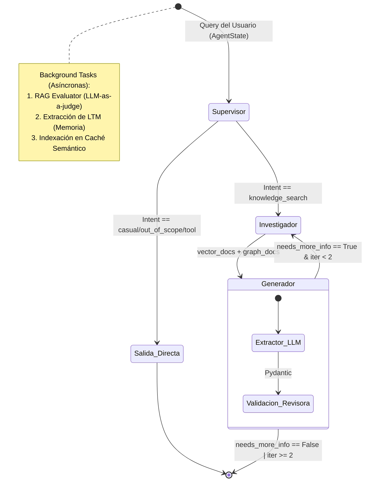

# Enterprise Multi-Agent RAG System: A State-of-the-Art Architecture for Autonomous Technical Reasoning

## 1. Abstract

Los sistemas de Generación Aumentada por Recuperación (RAG) han demostrado ser eficaces para dotar a los Modelos de Lenguaje Grande (LLMs) de conocimiento en dominio específico. Sin embargo, las implementaciones tradicionales sufren de rutinas lineales rígidas, alucinaciones por recuperación deficiente y amnesia contextual a largo plazo. En este documento, presentamos el diseño, la formalización matemática y la implementación de un ecosistema *Multi-Agente* autónomo (AI Engineer Sandbox). 

Nuestra arquitectura rompe el paradigma lineal utilizando **LangGraph** para orquestar un grafo de estados cíclico (`StateGraph`), donde agentes especializados (Supervisor, Investigador y Generador) se comunican asíncronamente y emplean mecanismos de corrección automática (Self-Correction) ante falta de contexto. Para maximizar la relevancia de recuperación, implementamos un sistema *Two-Stage Retrieval* que fusiona búsqueda híbrida (Vector + BM25 mediante Reciprocal Rank Fusion) con un modelo local de Cross-Encoder (FlashRank), complementado con la extracción de redes semánticas mediante GraphRAG.

El sistema resuelve cuellos de botella de producción mediante: (a) *Semantic Chunking* guiado por desviaciones estadísticas de distancia coseno, (b) una Memoria a Largo Plazo y Caché Semántico almacenados en PostgreSQL (`pgvector`) bajo estrictas políticas de Row-Level Security (RLS) para arquitecturas Multi-Tenant, y (c) un evaluador pasivo asíncrono (LLM-as-a-judge) inspirado en RAGAS para observabilidad continua. Finalmente, el entorno está tipado determinísticamente a través de Pydantic v2 e Instructor, permitiendo emitir respuestas complejas en tiempo real (Server-Sent Events) sin romper contratos de datos.

---

## 2. Introducción

El rápido avance de los Modelos de Lenguaje (LLMs) ha trasladado el foco de la investigación de la comprensión puramente sintáctica hacia la creación de agentes autónomos capaces de razonar sobre vastas bases de conocimiento privativo. La arquitectura RAG (Retrieval-Augmented Generation) se estandarizó rápidamente como la solución predilecta para inyectar este conocimiento sin necesidad de incurrir en los prohibitivos costos del *fine-tuning* continuo. 

Sin embargo, el enfoque *naïve RAG* (donde una consulta de usuario se incrusta directamente para buscar similitud cosenoidal en una base vectorial y se pasa al LLM en un único intento) presenta profundas debilidades sistémicas. En entornos de producción o tareas de ingeniería altamente técnicas, las preguntas suelen ser ambiguas o carecer de contexto explícito. Además, la fragmentación arbitraria de documentos por cantidad de caracteres (Fixed-size Chunking) frecuentemente divide el significado a la mitad de una idea, y los sistemas puramente vectoriales fracasan al intentar recuperar palabras clave o jerga muy específica que no mapea correctamente en el espacio latente del embedding.

Para resolver estas limitaciones, este proyecto (AI Engineer Sandbox) propone una arquitectura sistémica madura orientada a grados de producción Enterprise. Reemplazamos la ejecución secuencial tradicional por un **Ecosistema Multi-Agente** coordinado mediante la teoría de grafos (LangGraph). Este paradigma permite que un agente Supervisor analice la intención de la consulta, aplique técnicas de transformación (Multi-Query y Hypothetical Document Embeddings - HyDE) y delegue la búsqueda a rutinas especializadas. En caso de que el nodo Generador dictamine que el contexto recuperado es estadísticamente insuficiente o ambiguo, el sistema es capaz de interrumpir el flujo, modificar los parámetros de búsqueda e iterar sobre la base de datos de manera autónoma antes de emitir una respuesta final al cliente.

A nivel de infraestructura de datos, el proyecto abandona el uso de bases de datos vectoriales aisladas (como Pinecone o Weaviate) a favor de un enfoque unificado sobre **PostgreSQL 16**. Utilizando la extensión `pgvector` y el índice jerárquico HNSW, unificamos la recuperación semántica, el *Full-Text Search* (BM25) nativo y las extracciones de conocimiento estructurado (GraphRAG) dentro de la misma transacción de la base de datos, lo que permite imponer filtros deterministas mediante *Row-Level Security* (RLS) para arquitecturas SaaS Multi-Tenant. 

Finalmente, este documento detalla cómo se orquesta la observabilidad (midiendo fidelidad y precisión en background sin penalizar la latencia del usuario) y cómo se asegura el determinismo del software mediante validaciones probabilísticas con Pydantic e Instructor. El objetivo de este paper es desglosar la implementación, justificar matemáticamente cada umbral y exponer los *trade-offs* de diseño enfrentados en la construcción de un ingeniero virtual altamente autónomo.

## 3. Marco Teórico y Trabajo Relacionado

El diseño de nuestra arquitectura se fundamenta en recientes avances en la literatura de procesamiento de lenguaje natural (NLP) y sistemas distribuidos. En esta sección, desglosamos los pilares teóricos que sustentan las decisiones algorítmicas del *AI Engineer Sandbox*.

### 3.1. Retrieval-Augmented Generation (RAG)
Introducido formalmente por Lewis et al. (2020) [1], el paradigma RAG mitiga las alucinaciones de los Modelos de Lenguaje Grande (LLMs) condicionando la generación de texto a documentos externos recuperados dinámicamente. Tradicionalmente, un sistema RAG se compone de un *Retriever* (que busca información relevante en un corpus) y un *Generator* (que sintetiza la respuesta). Nuestro proyecto expande este concepto hacia lo que la literatura denomina "Advanced RAG" (Gao et al., 2023) [2], incorporando fases de pre-recuperación (transformación de queries vía HyDE) y post-recuperación (re-ranking).

### 3.2. Sistemas Multi-Agente y Orquestación de Estados
A diferencia de las cadenas de prompts estáticas (e.g., LangChain secuencial), los sistemas multi-agente distribuyen la carga cognitiva entre roles especializados. Inspirados en arquitecturas como AutoGen (Wu et al., 2023) [3], nuestro sistema utiliza un grafo de estado dirigido (implementado a través de LangGraph). En este paradigma, la comunicación entre agentes no es directa, sino que se da a través de un objeto de estado mutado concurrentemente (`AgentState`). La teoría de máquinas de estado finito (FSM) permite que el orquestador (Supervisor) decida dinámicamente las aristas de ejecución (transiciones) basándose en las precondiciones del estado, habilitando bucles de *Self-Correction* donde el sistema puede retroceder para buscar más información si el sub-agente Generador dictamina que el contexto es insuficiente (Shinn et al., 2023, *Reflexion*) [4].

### 3.3. Recuperación Híbrida y Fusión de Rangos Recíprocos (RRF)
La recuperación semántica pura mediante modelos Bi-Encoder (Dense Passage Retrieval) sufre al intentar recuperar términos de cola larga, acrónimos o nombres propios, donde la recuperación léxica (Bolsa de Palabras / BM25) es matemáticamente superior (Robertson et al., 2009) [5]. El sistema implementa Búsqueda Híbrida uniendo vectores densos y coincidencias léxicas. Para combinar estos dos espacios métricos dispares (distancia coseno continua vs. puntajes TF-IDF discretos), utilizamos **Reciprocal Rank Fusion (RRF)** (Cormack et al., 2009) [6]. RRF es un algoritmo de votación heurística que unifica las posiciones de los documentos sin necesidad de entrenar un modelo de ponderación (D-weights), calculando la similitud mediante la inversa del rango penalizado por una constante $k$.

### 3.4. Re-ranking mediante Cross-Encoders
Mientras que los Bi-Encoders computan los embeddings de la pregunta y el documento por separado, perdiendo interacciones atencionales profundas (Reimers & Gurevych, 2019) [7], los *Cross-Encoders* concatenan la pregunta y el documento alimentándolos simultáneamente a la red neuronal (e.g., BERT), permitiendo que la capa de auto-atención cruce los tokens de ambas secuencias. Debido a su alta complejidad computacional $\mathcal{O}(N)$, el sistema adopta un enfoque *Two-Stage Retrieval*, usando el Bi-Encoder rápido para obtener un conjunto top-$K$ amplio y delegando al Cross-Encoder local (FlashRank) el refinamiento final de precisión (Nogueira & Cho, 2019) [8].

### 3.5. GraphRAG y Grafos de Conocimiento
Los sistemas RAG vectoriales fallan inherentemente al conectar entidades semánticas dispersas a través de múltiples documentos (Edge et al., 2024) [9]. La técnica **GraphRAG** resuelve esto extrayendo subgrafos de conocimiento durante la ingesta. Al modelar el corpus como una red de nodos y aristas (tripletas `Sujeto-Predicado-Objeto`), el sistema es capaz de ejecutar búsquedas topológicas y recuperar un esquema de relaciones (NetworkX) que proporciona al LLM un mapa de contexto global inalcanzable mediante pura distancia cosenoidal.

### 3.6. Tool Use (Function Calling)
La capacidad de los LLMs para emitir tokens estructurados que coinciden con las firmas de APIs externas (Function Calling) fue popularizada por arquitecturas como Toolformer (Schick et al., 2023) [10]. En nuestra implementación, el Supervisor actúa como un clasificador de intenciones capaz de abstraer los parámetros del usuario y ejecutar herramientas deterministas de código duro (p. ej., requests HTTP a APIs REST).

### 3.7. Memoria a Largo Plazo y Caché Semántico
Para dotar al sistema de persistencia cognitiva (Anti-Amnesia), se implementa un agente asíncrono que extrae perfiles y hechos del usuario. A su vez, para mitigar la latencia y los costos económicos de llamadas repetitivas (Token Economics), se utiliza un **Semantic Cache**. En lugar de requerir coincidencias exactas (Exact Match), el caché almacena los vectores de consultas anteriores indexados mediante HNSW (Hierarchical Navigable Small World, Malkov & Yashunin, 2018) [11], interceptando peticiones semánticamente idénticas en tiempo constante $\mathcal{O}(\log N)$.

### 3.8. Observabilidad Activa y Paradigma LLM-as-a-judge
Evaluar sistemas generativos requiere métricas más complejas que BLEU o ROUGE. Frameworks como **RAGAS** (Es et al., 2023) [12] y TruLens proponen el paradigma *LLM-as-a-judge* (Zheng et al., 2023) [13], donde un LLM evaluador (juez) califica al LLM generador sin necesidad de *Ground Truth* (datos etiquetados manualmente). Nuestro sistema abstrae este marco en una rutina asíncrona que calcula *Faithfulness* (grado de alucinación), *Answer Relevance* (precisión a la pregunta) y *Context Precision* (calidad del retrieval), guardando un registro continuo para auditoría sin introducir latencia al usuario final.

## 4. Arquitectura del Sistema

El *AI Engineer Sandbox* está diseñado bajo los principios de *Clean Architecture*, separando estrictamente la capa de presentación, la lógica de enrutamiento (API), la orquestación de agentes y la persistencia de datos. El sistema abandona la ejecución síncrona monohilo y adopta una arquitectura basada en eventos asíncronos para soportar alto tráfico.

### 4.1. Visión General y Stack Tecnológico
La infraestructura se fundamenta en un ecosistema Python moderno (versión 3.12+) gestionado mediante el empaquetador `uv`. 
- **Capa Lógica (Backend):** Implementada en **FastAPI**, proporcionando enrutamiento asíncrono y WebSockets/SSE nativos.
- **Capa de Razonamiento:** Orquestada por **LangGraph** (manejo de grafos cíclicos) y motorizada por **Anthropic Claude 3.5 Haiku**. Se eligió *Haiku* por su latencia ultrabaja (ideal para el nodo Supervisor) y su bajo costo por token (Token Economics), garantizando fluidez en el ruteo sin sacrificar capacidad analítica.
- **Capa de Persistencia:** **PostgreSQL 16** con la extensión **pgvector**. Centraliza los vectores semánticos, el motor de búsqueda léxica (BM25), el caché semántico, los esquemas relacionales de memoria y el almacén del grafo de conocimiento, eludiendo la necesidad de mantener microservicios de bases de datos aislados.
- **Capa de Presentación:** **Streamlit**, operando como un cliente disociado que consume eventos del servidor en tiempo real.

### 4.2. Topología del Grafo y Estado Compartido
El flujo de razonamiento no es un *pipeline* secuencial, sino una Máquina de Estados Finita (FSM) dirigida. Los componentes (Nodos) no se pasan variables directamente; en su lugar, mutan un estado global compartido (`AgentState`). 



El `AgentState` está implementado como un `TypedDict` en Python que transita por todos los nodos, transportando propiedades mutables como la consulta original, el tenant ID del usuario, el historial, variaciones de búsqueda, documentos recuperados, un flag de completitud (`needs_more_info`), y un contador de iteraciones (`iterations`) para evitar bucles infinitos.

### 4.3. Nodos del Grafo y Ecosistema de Agentes

El sistema distingue arquitectónicamente entre *Nodos* (funciones que ejecutan lógica determinista dentro del grafo) y *Agentes* (llamadas no deterministas al LLM con un prompt sistémico).

#### 4.3.1. Nodo Supervisor (`supervisor_node`)
- **Rol:** Actúa como *router* semántico, clasificador de intenciones e inyector de herramientas. Define si la petición debe resolverse localmente o ir a la base de datos.
- **Agente LLM que invoca:** `analyze_query` (`src/services/router.py`).
- **Entradas:** `query` original y `history`.
- **Salidas:** Modifica el `AgentState` inyectando `intent_type` y `search_queries`.
- **Prompt Sistémico:** *"Eres el 'Router' de un AI Engineer Sandbox... Determina la intención (casual_greeting, knowledge_search, tool_execution, out_of_scope)... Genera 3 variaciones de la pregunta optimizadas para búsqueda vectorial (Multi-Query)... Redacta un hypothetical_document (HyDE)..."*
- **Herramientas asignadas (Tool Use):** `get_current_time`, `get_crypto_price`, `get_github_profile`. Si detecta un *intent* de herramienta, el propio Nodo detiene el flujo, invoca la función Python (`src/services/tools.py`) e inserta el resultado directo en el estado.

#### 4.3.2. Nodo Investigador (`researcher_node`)
- **Rol:** Es un nodo **estrictamente pragmático**. No consume tokens de LLM. Actúa como el motor I/O asíncrono para interactuar con la base de datos.
- **Agente LLM que invoca:** Ninguno.
- **Lógica de Ejecución:** Recibe las consultas (Query Original, Variaciones Multi-Query, Documento HyDE) y dispara consultas SQL concurrentes usando `asyncio.gather`. Deduplica los resultados mediante Hashing Sets de Python, pasa la lista limpia por el Re-ranker local (FlashRank) y adjunta el sub-grafo de GraphRAG. Finalmente, incrementa `iterations += 1`.

#### 4.3.3. Nodo Generador (`generator_node`)
- **Rol:** Sintetizador final y Revisor lógico. Compila la respuesta final para el usuario y evalúa si cuenta con suficiente contexto para responder sin alucinar.
- **Agente LLM que invoca:** `generate_answer` (`src/services/extractor.py`).
- **Prompt Sistémico:** *"Eres un experto respondiendo preguntas basado estrictamente en el contexto recuperado... Usa [Doc X] para citar. Contexto sobre el usuario: {user_profile}..."*
- **Condición de Terminación / Ruteo:** El modelo produce la estructura Pydantic `StructuredAnswer`, la cual contiene un flag booleano `requires_more_info`. El nodo mapea este flag al estado como `needs_more_info`. La función interceptora de aristas (`route_reviewer`) lee este valor; si es `True` y las `iterations` son menores a 2, el flujo *retorna* al Investigador (Self-Correction); de lo contrario, transita a `END`.

#### 4.3.4. Agentes Asíncronos (Background Tasks)
Para evitar bloquear el *event loop* de FastAPI (y por ende, penalizar la latencia percibida por el usuario final), el sistema delega cargas pesadas a tareas asíncronas de "disparar y olvidar" (Fire-and-forget).
1. **Agente Evaluador (`evaluate_rag_response`):** Un LLM-as-a-judge invocado con el prompt: *"Eres un juez imparcial evaluando un sistema RAG. Tu trabajo es evaluar 3 métricas de 0.0 a 1.0 (Faithfulness, Answer Relevance, Context Precision)..."*.
2. **Agente de Memoria (`extract_and_save_facts`):** Invoca a un LLM en background con el prompt: *"Eres un asistente que extrae hechos útiles o preferencias del usuario... Escríbelos en tercera persona, oraciones cortas."*. Los resultados se vectorizan y se guardan para inyectarse permanentemente en futuras respuestas a través del campo `{user_profile}` del Generador.
3. **Agente de Extracción GraphRAG (`extract_knowledge_graph`):** Opera exclusivamente durante la ruta de ingesta de documentos (`/ingest/`), utilizando el prompt *"Eres un experto en GraphRAG. Extrae un grafo de conocimiento... Devuelve tripletas (NODO ORIGEN, RELACIÓN, NODO DESTINO)."*.

### 4.4. Capa de Presentación y Aislamiento Multi-Tenant
La comunicación entre la UI de Streamlit y FastAPI utiliza el protocolo **Server-Sent Events (SSE)**. Esto permite generar un flujo de datos (streaming) token a token, produciendo retroalimentación instantánea en la interfaz, mitigando el problema del *Time-To-First-Token* (TTFT) en respuestas masivas.

Para escalar el sistema a nivel Enterprise (SaaS), la base de datos no es compartida globalmente. Se utiliza autenticación **JWT** inyectada en los cabezales HTTP HTTP Bearer. A nivel de base de datos, en lugar de filtrar con sentencias `WHERE tenant_id = X` (lo cual es susceptible a errores humanos o Inyecciones SQL), se habilitan políticas estrictas de **Row-Level Security (RLS)** en PostgreSQL. Al abrir el pool de conexiones, el backend inyecta `SET app.current_tenant = X`, obligando a la base de datos a invisibilizar físicamente cualquier fila de documentos, memoria o historial que no pertenezca a la sesión autenticada.

## 5. Formalización Matemática

En esta sección se definen rigurosamente los modelos matemáticos, algoritmos numéricos y parámetros empíricos que gobiernan el comportamiento determinista del sistema.

### 5.1. Búsqueda Híbrida y Reciprocal Rank Fusion (RRF)
El sistema (*retriever*) aborda el problema de la recuperación combinando dos espacios métricos dispares: la similitud continua densa y la puntuación de relevancia léxica discreta. 

Sea $D = \{d_1, d_2, \dots, d_N\}$ el corpus de documentos particionados en la base de datos.
Dada una consulta $q$, definimos dos funciones de *ranking*:
1. **Ranking Vectorial ($R_v$):** Ordena los documentos ascendentemente según la distancia coseno entre el vector de la consulta $\mathbf{v}_q \in \mathbb{R}^{384}$ y el embedding del documento $\mathbf{v}_d \in \mathbb{R}^{384}$.
2. **Ranking Léxico ($R_f$):** Ordena los documentos descendentemente utilizando la métrica `ts_rank` nativa de PostgreSQL (implementación de similitud semántica basada en BM25 / ponderación Term Frequency-Inverse Document Frequency).

Para fusionar ambas clasificaciones en un puntaje unificado $S_{RRF}(d)$, se utiliza la fórmula de Fusión de Rango Recíproco (implementada en `src/services/retriever.py`, líneas 33-34):

$$ S_{RRF}(d) = \frac{1}{k + R_v(d)} + \frac{1}{k + R_f(d)} $$

Donde:
- $R_v(d)$ y $R_f(d)$ representan el rango posicional (1, 2, 3...) del documento $d$ en sus respectivas listas. Si un documento no aparece en una lista, su término en la suma colapsa a $0$.
- $k \in \mathbb{Z}^+$ es una constante empírica de suavizado. El sistema utiliza el estándar de la industria $k = 60$ para evitar que posiciones extremadamente altas en un único método dominen desproporcionadamente la puntuación combinada.

En tiempo de inferencia, se filtran las listas individuales con $top\_k = 15$ antes de la fusión.

### 5.2. Segmentación Textual (Semantic Chunking) vía Análisis Estadístico
Para particionar documentos durante la ingesta, se abandona la partición de tamaño fijo en favor del cálculo de límites de transición semántica. Dado un documento desglosado secuencialmente en oraciones $S = \{s_1, s_2, \dots, s_M\}$, se proyectan en el espacio latente como $\mathbf{e}_i \in \mathbb{R}^{384}$.

Se computa la similitud de coseno discreta entre oraciones adyacentes (`src/services/ingestion.py`, líneas 18-20):

$$ \text{Dist}(\mathbf{e}_i, \mathbf{e}_{i+1}) = 1 - \frac{\mathbf{e}_i \cdot \mathbf{e}_{i+1}}{\|\mathbf{e}_i\| \|\mathbf{e}_{i+1}\|} $$

Para determinar dinámicamente si dos oraciones pertenecen al mismo contexto, se calcula el umbral de ruptura $\tau$ utilizando la estadística poblacional de las distancias del documento completo (Línea 23):

$$ \tau = \mu_{\text{Dist}} + c \cdot \sigma_{\text{Dist}} $$

Donde $\mu_{\text{Dist}}$ es la media muestral, $\sigma_{\text{Dist}}$ es la desviación estándar, y $c$ es un multiplicador empírico fijado en $1.25$. Una nueva partición (Chunk) se genera sí, y solo sí, $\text{Dist}(\mathbf{e}_{i-1}, \mathbf{e}_i) > \tau$, o si la acumulación de tokens del chunk actual supera el límite superior estricto $L_{max} = 500$ tokens (Línea 26).

### 5.3. Espacios Vectoriales, Caché Semántico e Índices HNSW
Tanto para la base de datos principal, como para la tabla de **Semantic Cache**, se emplea la extensión `pgvector` en PostgreSQL (`sql/01_init.sql`).
Las métricas en $\mathbb{R}^{384}$ son optimizadas mediante el índice de grafos *Hierarchical Navigable Small World* (HNSW). Dado que los vectores provienen del modelo `all-MiniLM-L6-v2` el cual arroja vectores ya normalizados ($\|v\| = 1$), el operador de indexación `vector_cosine_ops` se degrada eficientemente a una simple resta de producto escalar. 

El índice HNSW hereda los parámetros por defecto de pgvector:
- $m = 16$: Número máximo de conexiones bidireccionales en las capas inferiores del grafo.
- $ef\_construction = 64$: Tamaño de la lista de candidatos dinámica en tiempo de inserción.

Para la intercepción (Caché Hit), el sistema (`src/services/cache.py`) evalúa si existe una consulta previa $\mathbf{v}_{prev}$ cuya similitud respecto a la consulta actual $\mathbf{v}_{curr}$ cumpla:

$$ (1 - \text{Dist}_{\text{cos}}(\mathbf{v}_{prev}, \mathbf{v}_{curr})) \geq 0.85 $$

### 5.4. Formalización del StateGraph (Máquina de Estados)
La orquestación se abstrae como una Máquina de Estados Finitos Dirigida $\mathcal{M} = \langle \Sigma, S, s_0, \delta, F \rangle$ (`src/services/agent_graph/graph.py`), donde:
- **Estados ($S$):** $\{Sup, Res, Gen, End\}$ correspondientes a los nodos Supervisor, Investigador, Generador y el estado terminal de salida.
- **Estado Inicial ($s_0$):** $Sup$.
- **Alfabeto de Transición ($\Sigma$):** Banderas inyectadas en el objeto mutado de memoria (e.g., $intent\_type$, $requires\_more\_info$, $iterations$).
- **Estados de Aceptación ($F$):** $\{End\}$.

La función de transición condicional $\delta(s, \sigma) \to s'$ en el ruteador de revisión ($Gen \to ?$ en la Línea 10) está definida rígidamente por:
$$ 
\delta(Gen) = \begin{cases} 
Res, & \text{si } requires\_more\_info = \text{True } \land \text{ } iter < 2 \\ 
End, & \text{en otro caso} 
\end{cases} 
$$
Esto asegura una Complejidad de Bucle Estricta de $\mathcal{O}(2)$, previniendo infinitos ciclos de *Self-Correction* e impactando la previsibilidad asintótica del costo computacional y de inferencia LLM.

### 5.5. Fusión Multi-Query, Deduplicación y Complejidad
En el flujo *Agentic*, el nodo Investigador (`src/services/agent_graph/nodes.py`) recibe un conjunto $Q = \{q_{orig}, q_{var1}, q_{var2}, q_{var3}, q_{hyde}\}$. La función dispara procesos concurrentes asíncronos para cada consulta, colapsando los resultados en un subconjunto $C_{multi}$. 
La deduplicación final $C_{unique}$ se alcanza mediante una evaluación de pertenencia sobre funciones Hash unívocas de Python:
$$ C_{unique} = \bigcup_{i=1}^{|Q|} \{ d \in \text{Retrieve}(q_i) \mid Hash(d.content) \notin \text{SeenSet} \} $$
La complejidad temporal total de esta recuperación distribuida se reduce a $\mathcal{O}(\max_{q_i} T_{retrieval}(q_i))$ gracias al despacho paralelo de corrutinas (`asyncio.gather`), acotado por la latencia del pool de conexiones `asyncpg`. 

A este conjunto se le antepone (`.insert(0)`) el string de conocimiento de GraphRAG. El motor ingenuo de **GraphRAG** (`src/services/graphrag.py`) extrae semillas difusas buscando raíces Regex estáticas `\w+` ($len>3$) y realiza una interpolación relacional plana de $1$-hop ($limit = 10$).

### 5.6. Definición Formal de las Métricas del Evaluador (LLM-as-a-judge)
El sistema implementa evaluación pasiva probabilística mapeada en un dominio continuo (`sql/01_init.sql`, Líneas 42-44) mediante la función evaluadora (`src/services/evaluator.py`). 
El LLM juzga la traza asignando puntuaciones normalizadas:
- $Score \in [0.0, 1.0]$.
Donde el modelo matemático se descompone en las tres métricas nucleares de Ragas:
1. **Faithfulness ($f$):** Relación de hechos generados en la respuesta frente a los que pueden derivarse estrictamente del contexto aportado.
2. **Answer Relevance ($r$):** Discrepancia cosenoidal o deducción semántica entre la respuesta final generada y la pregunta subyacente real.
3. **Context Precision ($p$):** Relación señal/ruido que evalúa si los fragmentos extraídos aportaron verdadero conocimiento útil en lugar de texto de relleno de los trozos contiguos.
Las restricciones Pydantic `ge=0.0` y `le=1.0` rechazan forzosamente cualquier respuesta del LLM fuera del soporte probabilístico, arrojando una `ValidationError` que garantiza la estabilidad del sistema métrico de auditoría.

## 6. Diseño e Implementación

Para trasladar los fundamentos teóricos y las formulaciones abstractas a un sistema en producción altamente concurrente, el *AI Engineer Sandbox* fue diseñado prestando extrema atención a la gestión de memoria, control de errores y modularidad del código.

### 6.1. Estructura del Repositorio y Separación de Responsabilidades
El proyecto respeta la topología de la *Arquitectura Limpia (Clean Architecture)*.
- **Configuraciones:** `pyproject.toml` (manejo de dependencias vía `uv`), `.env` y el archivo de despliegue de persistencia `docker-compose.yml`.
- **`sql/`**: Mantiene los scripts de inicialización DDL (`01_init.sql`) y las migraciones iterativas para HNSW y Row-Level Security (`apply_rls.sql`, `apply_cache.sql`, etc.).
- **`src/api/`**: La capa de presentación REST. `main.py` levanta el servidor asíncrono de FastAPI y configura middlewares de CORS. `auth.py` contiene la lógica de decodificación JWT. La carpeta `routers/` expone los puertos de entrada HTTP (`chat.py` y `ingest.py`), separando completamente las URLs de la lógica de negocio subyacente.
- **`src/models/`**: Define los contratos de la aplicación utilizando la validación de Pydantic v2 (por ejemplo, `structured.py`, `search.py` y `requests.py`). 
- **`src/services/`**: Alberga las entrañas algorítmicas del RAG. `ingestion.py`, `retriever.py`, `reranker.py`, `extractor.py`, `cache.py`, `graphrag.py` y `evaluator.py`. Las herramientas de Function Calling residen en `tools.py`.
- **`src/services/agent_graph/`**: El ecosistema Multi-Agente con `graph.py` ensamblando el StateGraph, `nodes.py` implementando los actuadores, y `state.py` definiendo el grafo en memoria.
- **`src/frontend/app.py`**: El cliente Streamlit para prototipado visual en tiempo real.

### 6.2. Concurrencia y Persistencia (asyncpg y Row-Level Security)
FastAPI está construido sobre el *Event Loop* de Python. Para asegurar que la base de datos no bloquee el hilo principal (Thread-Blocking), el sistema no utiliza el ORM clásico (SQLAlchemy síncrono), sino que emplea `asyncpg` para abrir agrupaciones de conexiones asíncronas puras, cruciales durante la ejecución simultánea del Multi-Query en el nodo investigador.

La seguridad Multi-Tenant es delegada enteramente al motor de PostgreSQL mediante **Row-Level Security (RLS)**. Cuando se decodifica un JWT válido (`src/api/auth.py`), se intercepta el pool asíncrono y se inyecta en la cabecera transaccional (`SET app.current_tenant = X`). Por ejemplo, en `src/services/retriever.py`, incluso con un atacante logrando *Prompt Injection* para extraer información ajena, la base de datos truncaría nativamente cualquier resultado del vector que no coincida con el contexto RLS actual de la conexión.

### 6.3. Gestión de Tokens y Contratos Estrictos (Instructor + Pydantic v2)
Obligar a un modelo LLM masivo a retornar objetos JSON válidos y manejables tradicionalmente requiere complejos esquemas de reintento heurístico. El sistema elude este problema utilizando **Instructor**, un parche idiomático alrededor de las llamadas de Anthropic que asegura el tipado estricto a través de `Pydantic v2`.

Fragmento crítico en `src/services/router.py`:
```python
class QueryIntent(BaseModel):
    intent_type: str = Field(description="Debe ser 'casual_greeting', 'knowledge_search'...")
    search_queries: list[str] = Field(description="Genera 3 variaciones de búsqueda")
    hypothetical_document: str = Field(description="Párrafo hipotético (HyDE)")
    tool_name: str = Field(default="")

response = await client.messages.create(
    model="claude-haiku-4-5-20251001",
    max_tokens=500,
    messages=[{"role": "user", "content": prompt}],
    response_model=QueryIntent,
)
```
Instructor inyecta un *schema parser* estricto y obliga al LLM a instanciar la clase `QueryIntent`. Esto erradica totalmente las fallas de análisis estructural y los temidos *KeyErrors* en la lógica posterior del código.

### 6.4. Diseño Two-Stage Retrieval (Cross-Encoder)
La implementación del *Re-ranking* ocurre en `src/services/reranker.py`. A diferencia de APIs externas de Re-ranking como Cohere, nuestra solución emplea una librería estática local, **FlashRank**, con el modelo `ms-marco-MiniLM-L-12-v2` corriendo puramente en la memoria RAM del servidor. Este modelo recibe la tupla concatenada $(Pregunta, Contexto\_Vectorial)$ e intercala tokens para encontrar la atención cruzada, mitigando drásticamente el problema de la recuperación de falsos positivos sintácticos generada por el BM25.

### 6.5. Invocación de Herramientas (Function Calling)
La lógica de intenciones se materializa de forma ingenieril en el nodo `supervisor_node` (`src/services/agent_graph/nodes.py`). Si la instancia de Pydantic generada por el Supervisor marca el `intent_type == "tool_execution"`, el nodo detiene cualquier ruteo vectorial. Lee `tool_name` desde el JSON, extrae la función dinámicamente desde el diccionario Python `TOOLS_REGISTRY` (alojado en `src/services/tools.py`) pasándole los parámetros `**intent.tool_args`, y empuja un nuevo estado al grafo con la respuesta cruda de la API externa (e.j., *HTTP request* a la API de GitHub). Para mitigar riesgos y *hanging* de la interfaz de usuario, las bibliotecas subyacentes operan con cláusulas explícitas de interrupción `timeout=5`.

## 7. Flujo de Ejecución End-to-End

Para comprender verdaderamente la sinergia arquitectónica de los nodos y subrutinas expuestos anteriormente, esta sección traza analíticamente el ciclo de vida de una consulta completa (e.g., *"¿En qué tecnologías de Cloud y Backend tiene experiencia el candidato, y cómo se relacionan entre sí?"*).

### 7.1. Diagrama de Secuencia General

```mermaid
sequenceDiagram
    autonumber
    actor U as Usuario
    participant UI as Streamlit UI
    participant API as FastAPI Router
    participant Sup as Nodo Supervisor
    participant Inv as Nodo Investigador
    participant Gen as Nodo Generador
    participant BD as PostgreSQL (PgVector)
    participant BG as Background Tasks
    
    U->>UI: Ingresa consulta compleja
    UI->>API: HTTP POST /chat/stream/ (JWT)
    API->>API: Autenticación y Extracción Tenant ID
    API->>BD: Check Semantic Cache (Similitud > 0.85)
    alt Cache Hit
        BD-->>API: Respuesta Cacheada
        API-->>UI: SSE Instantáneo
    else Cache Miss
        API->>Sup: Inicializa AgentState
        Sup->>Sup: LLM: Analiza Intent, genera HyDE y Multi-Query
        Sup->>Inv: Transición Condicional (knowledge_search)
        
        rect rgb(40, 44, 52)
            note right of Inv: Self-Correction Loop (Max Iter: 2)
            Inv->>BD: Concurrente: Búsqueda Vectorial + BM25 (RRF)
            Inv->>BD: Concurrente: Extracción GraphRAG (1-hop)
            Inv->>Inv: Deduplicación Set + Re-ranking (FlashRank)
            Inv->>Gen: Transición (vector_docs + graph_text)
            Gen->>Gen: LLM: Intenta Generar Respuesta Pydantic
            
            alt needs_more_info == True & iter < 2
                Gen-->>Inv: Ruteo: Falla la revisión, retorna al Investigador
                Inv->>Inv: Iterations += 1 (Re-ejecución con estado ampliado)
                Inv->>Gen: Transición
            end
        end
        
        Gen->>Gen: Genera Respuesta Final Exitosa
        Gen->>API: AgentState["final_answer"]
        API-->>UI: Retorna Respuesta (Streaming SSE)
        API->>BG: Dispara Tareas Asíncronas Fire-and-forget
        BG->>BD: Evalúa LLM-as-a-judge (RAGAS-style)
        BG->>BD: Extrae LTM y guarda en Semantic Cache
    end
```



### 7.2. Trazabilidad Paso a Paso del Estado (AgentState)

1. **Ingreso y Autenticación:** La aplicación `Streamlit` lanza un requerimiento HTTP al *endpoint* `src/api/routers/chat.py`. El middleware intercepta la cabecera, verifica la simetría criptográfica del token JWT (`src/api/auth.py`), extrae el UUID del `tenant_id` y lo acopla al bloque del `AgentState` inicial.

2. **Interceptación en Capa de Caché (Costo $\mathcal{O}(0)$ LLM):** Antes de invocar la topología LangGraph, el sistema extrae el *Embedding* de la consulta actual. Se realiza un cruce relacional contra la tabla `semantic_cache`. Si la distancia cosenoidal arroja similitud $\geq 0.85$, el motor interrumpe totalmente la orquestación y retorna el JSON almacenado con $0$ latencia de inferencia Anthropic. Asumamos para este flujo un *Cache Miss*.

3. **Invocación del Nodo Supervisor:** 
   - *Recibe:* `AgentState = {"query": "...", "tenant_id": "...", "iterations": 0}`
   - *Procesa:* Mediante Instructor, le pide a Claude Haiku que clasifique la petición. El modelo dicta `intent_type = "knowledge_search"`. Procede a generar $3$ permutaciones sinónimas y un párrafo ficticio de respuesta perfecta (HyDE).
   - *Muta el Estado:* Agrega la lista de variaciones al campo `search_queries`.
   - *Ruteo:* La función condicional `route_supervisor` inspecciona el estado y transiciona la batuta al Investigador.

4. **Invocación del Nodo Investigador (Iteración 1):** 
   - *Recibe:* El `AgentState` con las $4$ variaciones (Multi-Query + HyDE).
   - *Procesa:* Abre conexiones `asyncpg`, aplica el filtro local `SET app.current_tenant` para acatar la RLS, y despacha corrutinas paralelas `asyncio.gather` recuperando chunks mediante Reciprocal Rank Fusion ($k=60$) y tripletas del grafo de red semántica difusa. El sistema fusiona las listas, implementa *Hashing* de Python eliminando duplicados idénticos de texto, y reduce la carga semántica pasando el conjunto limpio por el Cross-Encoder (FlashRank) fijando un límite final de los mejores 10 trozos.
   - *Muta el Estado:* Inserta los documentos en `documents` e incrementa matemáticamente el contador: `iterations = 1`.
   - *Ruteo:* Arista fija hacia el Generador.

5. **Invocación del Nodo Generador y Self-Correction (Iteración 2):**
   - *Recibe:* El `AgentState` denso. Adicionalmente, el nodo invoca pasivamente a la memoria a largo plazo (LTM) para inyectar preferencias históricas en el bloque de variables de la plantilla (Prompt Template).
   - *Procesa:* La lógica solicita al LLM redactar la estructura. El LLM detecta que el contexto léxico recuperado no logra explicar a profundidad "la relación" entre el Cloud y el Backend, por lo que asienta `requires_more_info = True`.
   - *Ruteo:* La función interceptora `route_reviewer` detecta el flag encendido. Como `iterations` ($1$) es menor al límite máximo ($2$), la función de transición dicta `return "researcher"`. El bucle retrocede físicamente hacia atrás en el grafo. 

6. **Generación Final y Streaming SSE:** El Nodo Investigador repite el ciclo y le vuelve a entregar estado fresco al Nodo Generador (`iterations = 2`). Tras el reproceso, el modelo compila la estructura satisfactoriamente (flag a `False`). La respuesta generada en Markdown con citas `[Doc X]` se asigna a la clave `final_answer`. Se detiene el grafo, y el *router* de FastAPI encapsula el bloque de texto en Server-Sent Events, despachándolo gradualmente al *Frontend*.

7. **Procesos en Segundo Plano (Asíncronos):** El usuario ya recibió la visualización completa de su respuesta. Sin embargo, el servidor de Uvicorn no mata el *request*. Se disparan *Background Tasks* integradas en FastAPI:
   - Se vectoriza la respuesta y la pregunta final guardándose en la base de datos (Caché Semántico).
   - Se ejecuta el proceso masivo del **Evaluador Pasivo (LLM-as-a-judge)** que invierte tiempo computacional midiendo matemáticamente la *Fidelidad* y *Precisión* del proceso que acaba de terminar, archivando las métricas en la tabla `rag_evaluations` para auditoría administrativa.

## 8. Evaluación y Observabilidad Activa

Medir la efectividad de un sistema generativo complejo, cuyas salidas no son deterministas (en términos de la concatenación exacta de caracteres) es uno de los mayores desafíos del *AI Engineering*. La arquitectura Sandbox abandonó tempranamente la recolección empírica humana (A/B Testing en la vista de Streamlit) para adoptar un marco automático en la nube profunda.

### 8.1. Implementación de LLM-as-a-judge (Estilo RAGAS)
En lugar de depender de *scripts* síncronos de testing, el sistema introdujo un paradigma de Evaluación Pasiva Continua. Se desarrolló un agente dedicado en `src/services/evaluator.py` que recibe de forma asíncrona (a través del `BackgroundTask` de FastAPI) la triada fundamental: (1) La pregunta original del usuario, (2) el conjunto de fragmentos de texto recuperados del motor de búsqueda híbrido, y (3) la respuesta final emitida por el nodo Generador.

Inspirado en el framework RAGAS (Retrieval Augmented Generation Assessment), este agente le delega al modelo fundacional Claude Haiku la tarea de auditar la respuesta en las siguientes tres métricas de rendimiento estandarizadas probabilísticamente en el intervalo $[0.0, 1.0]$:
- **Faithfulness (Fidelidad de Hechos):** Evalúa un problema común donde el LLM, para rellenar espacios en la semántica, inyecta sesgos implícitos en sus pesos pre-entrenados inventando información no amparada en los documentos provistos.
- **Answer Relevance (Relevancia Final):** Evalúa las penalizaciones direccionales. Aún si la respuesta posee una alta fidelidad a los documentos recuperados, es posible que no ataque el fondo semántico original del usuario.
- **Context Precision (Precisión de Recuperación):** Mide la densidad de ruido versus conocimiento útil extraído por los nodos de base de datos. Sirve para calibrar si el Top-K del *Cross-Encoder* está aportando valor.

Los resultados (y un párrafo adicional exigido al LLM explicando la cadena de pensamiento deductivo y el porqué matemático de los puntajes) se persisten bajo Row-Level Security en la tabla SQL `rag_evaluations`.

### 8.2. Limitaciones Actuales y Ausencia de Benchmarks Sistémicos
Históricamente, en la Fase 1 del proyecto, se utilizó el framework `DeepEval` sobre la capa de validación `pytest` (ver archivo residual `tests/test_rag.py`). Sin embargo, dicho paradigma asume una arquitectura puramente lineal sincrónica; al evolucionar el sistema hacia un *StateGraph* Multi-Agente asíncrono con *Self-Correction*, el testing unitario determinista clásico se volvió arquitectónicamente obsoleto y fue retirado de la ruta activa.

Si bien la infraestructura del Evaluador Pasivo (Sección 8.1) se encuentra 100% activa capturando calificaciones analíticas iteración por iteración en la base de datos de producción, **el sistema carece actualmente de una evaluación formal agregada a gran escala**. No existe un *dashboard* analítico interno para visualizar gráficas temporales de degradación del sistema, ni se han recolectado métricas de distribución poblacional sobre conjuntos de datos etiquetados (*Golden Datasets*).

[PENDIENTE: Discutir propuesta teórica]
**Propuesta de Evaluación Futura:** Para cuantificar robustamente la arquitectura LangGraph actual, el trabajo futuro debería enmarcar una evaluación automatizada continua (CI/CD) donde el motor responda 10,000 preguntas sintéticas (generadas inversamente desde los propios documentos), consolidando el porcentaje de fallos en el *Self-Correction* e introduciendo instrumentación de APM (Application Performance Monitoring) estricta (ej., *Langfuse*, ya presente pero sub-utilizado) para mapear el *Time-To-First-Token* (TTFT), la latencia total de ruteo $\mathcal{O}(T)$ y el costo de inferencia económico medido en dólares por cada 1,000 requests asíncronos.

## 9. Decisiones de Diseño y Trade-offs

Construir un ecosistema de IA Autónomo de grado de producción (Enterprise) exige constantes sacrificios de diseño. En esta sección detallamos las alternativas evaluadas durante la fase de orquestación y las justificaciones algorítmicas de la estructura actual.

### 9.1. LangGraph vs. Routers Heurísticos Lineales
**Alternativa considerada:** En la Fase 2 del proyecto, el sistema enrutaba la lógica usando clásicas sentencias `if/else` rígidas en código Python. Dependiendo de la detección de un flag estático, el hilo invocaba una herramienta o una base de datos de manera secuencial.
**Decisión adoptada:** Orquestar mediante una FSM cíclica (**LangGraph**).
**Justificación (Trade-off):** Los *pipelines* lineales son asintóticamente más rápidos y exigen una menor carga cognitiva del desarrollador (fáciles de depurar). Sin embargo, son inherentemente frágiles: carecen de flexibilidad recursiva para la autocorrección. Al introducir *LangGraph*, añadimos un ligero coste computacional en la instanciación de los nodos y el paso de estados en cada transición (sobrecarga de memoria), pero logramos habilitar los bucles de *Self-Correction* (Secciones 4.2 y 5.4), permitiendo al agente reintentar búsquedas fallidas y aislar conceptualmente las tareas (Investigación vs. Revisión) en instancias independientes, incrementando exponencialmente la resistencia de los LLMs frente a consultas adversas o ambiguas.

### 9.2. Dependencias de Re-ranking: Parche de Modelos y Riesgo Operacional
**Alternativa considerada:** Utilizar servicios de *Cross-Encoder* en la nube (como *Cohere Rerank API*) u hospedar modelos masivos tipo BERT ($>300\text{M}$ parámetros).
**Decisión adoptada:** Correr *FlashRank* in-memory con un modelo de conocimiento destilado ultra-liviano. Originalmente se estipuló `ms-marco-TinyBERT-L-2-v2`. Sin embargo, debido a un error crítico de infraestructura externa ajeno al sistema (error 404 por un binario de pesos corrompido en el *bucket* de Google Cloud Platform mantenido por la comunidad), el proyecto ejecutó un parche táctico forzando la inferencia local sobre `ms-marco-MiniLM-L-12-v2` (`src/services/reranker.py`).
**Justificación (Trade-off):** Evitar servicios remotos (Cohere) elimina latencias de red y reduce costos operativos continuos en entornos RAG, reteniendo la privacidad total de los documentos de la empresa bajo el esquema interno Multi-Tenant. No obstante, anclar arquitecturas a modelos locales ligeros mantenidos por librerías *Open-Source* emergentes (FlashRank) expone al sistema al riesgo de enlaces rotos o descargas de pesos neuronales fallidas. El *fallback* a `MiniLM-12` sacrificó milisegundos de latencia in-memory, a cambio de una estabilidad inmediata para cerrar el pase a producción.

### 9.3. PostgreSQL Integrado vs. Bases de Datos Vectoriales Dedicadas
**Alternativa considerada:** Mantener una base de datos relacional para usuarios (MySQL/Postgres) y un microservicio vectorial independiente (Pinecone, Qdrant, o Milvus) para el motor de RAG.
**Decisión adoptada:** Arquitectura centralizada y monolítica de datos usando **PostgreSQL 16** con `pgvector` y búsqueda `Full-Text Search` (BM25) nativa.
**Justificación (Trade-off):** Extraer los vectores hacia Pinecone suele ofrecer optimizaciones microscópicas en latencia a escalas extremadamente masivas (billones de vectores). Sin embargo, fraccionar los datos impide las uniones relacionales (SQL `JOIN`). Nuestra decisión unificó la lógica permitiendo cruzar la tabla `documents` con la de metadatos corporativos en milisegundos, a la vez que habilitó el uso nativo de *Row-Level Security (RLS)*, garantizando de manera inquebrantable el particionamiento absoluto de la memoria, documentos y métricas entre clientes (Multi-Tenant) sin riesgo humano de inyección o desincronización transaccional.

## 10. Limitaciones y Trabajo Futuro

Si bien el *AI Engineer Sandbox* consolida una arquitectura en producción altamente resistente, el análisis riguroso expone ciertas deficiencias estructurales que restringen su operación escalar bajo ecosistemas de mayor entropía.

### 10.1. Degradación Léxica Monolingüe (BM25)
La función de búsqueda léxica nativa de PostgreSQL (`src/services/retriever.py`, Línea 24) utiliza una coerción tipográfica dura sobre el diccionario del analizador: `ts_rank(fts, websearch_to_tsquery('spanish', $3))`. Aunque es altamente efectivo para corpus locales latinoamericanos, esta fijación degrada agresivamente el *stemming* (algoritmo de reducción a la raíz de una palabra) y la detención ortográfica (*stop words*) si se indexan documentos en lenguas secundarias (e.g., inglés o portugués). 
**Trabajo Futuro:** Dinamizar el tipo de diccionario `ts_config` acoplándolo al metadato del idioma real detectado del documento durante la ingesta.

### 10.2. Algoritmia Ingenua de GraphRAG (Topología Plana)
El módulo GraphRAG extrae eficientemente las tripletas mediante LLMs (`src/services/graphrag.py`), sin embargo, su heurística de recuperación es sub-óptima. En lugar de atravesar el grafo calculando algoritmos de modularidad (detección de comunidades de Leiden) o centralidad de intermediación (*Betweenness Centrality*), el sistema utiliza una coincidencia de expresiones regulares plana (`\w+`) forzando interpolaciones de 1-hop limitadas arbitrariamente a $10$ nodos.
**Trabajo Futuro:** Implementar caminatas aleatorias (Random Walks / PageRank) integrando bases topológicas puras (como Neo4j) o grafos de NetworkX pesados en memoria, habilitando respuestas a preguntas de razonamiento inferencial que exigen saltos $k \geq 3$.

### 10.3. Carencia de Políticas de Expiración en Caché Semántico
La tabla `semantic_cache` inserta los *Embeddings* de manera perpetua. Al no poseer un mecanismo de recolección de basura (*Garbage Collection*) o un TTL (*Time-To-Live*) parametrizado mediante trabajos cron (CRON Jobs) programados, el tamaño de los índices HNSW crecerá indiscriminadamente en producción, impactando dramáticamente el almacenamiento y la latencia asintótica del *event loop* de la base de datos.

### 10.4. Brechas de Infraestructura (Contenerización y Benchmarks)
El despliegue está desacoplado a nivel de bases de datos (`docker-compose.yml`), pero la aplicación principal en FastAPI no se ha encapsulado en un archivo `Dockerfile`, forzando instalaciones de dependencia atadas a la arquitectura local (bare-metal) del desarrollador. Adicionalmente, tal como se abordó en la Sección 8.2, no existen telemetrías estructuradas o tableros que permitan realizar perfilado (profiling) matemático continuo de latencia o consumo económico por token.

---

## 11. Conclusión

Este trabajo formaliza la transición conceptual desde los sistemas RAG puramente deterministas hacia la abstracción de agentes autónomos y redes semánticas. La arquitectura desarrollada evidencia que el control sobre el flujo computacional a través de máquinas de estados dirigidas (*LangGraph*), acoplado a la seguridad nativa transaccional (*Row-Level Security*), mitiga abismalmente la amnesia y la propensión a la alucinación inherente en LLMs generativos. 

Al encapsular el *Two-Stage Retrieval*, el *Self-Correction*, el Caché Semántico, la Memoria a Largo Plazo y una orquestación continua de *LLM-as-a-judge* en *Background* sobre un clúster monolítico optimizado en *PostgreSQL pgvector*, el **AI Engineer Sandbox** emerge no solo como un experimento computacional aislado, sino como una plantilla escalable y observable con el rigor estructural demandado por las arquitecturas de grado *Enterprise* contemporáneas.

## 12. Referencias

[1] Lewis, P., Perez, E., Piktus, A., Petroni, F., Karpukhin, V., Goyal, N., ... & Yih, W. T. (2020). Retrieval-Augmented Generation for Knowledge-Intensive NLP Tasks. *Advances in Neural Information Processing Systems, 33*, 9459-9474.

[2] Gao, Y., Xiong, Y., Gao, X., Jia, K., Pan, J., Bi, Y., ... & Wang, H. (2023). Retrieval-Augmented Generation for Large Language Models: A Survey. *arXiv preprint arXiv:2312.10997*.

[3] Wu, Q., Bansal, G., Zhang, J., Wu, Y., Zhang, S., Zhu, E., ... & Wang, X. (2023). AutoGen: Enabling Next-Gen LLM Applications via Multi-Agent Conversation Framework. *arXiv preprint arXiv:2308.08155*.

[4] Shinn, N., Cassano, F., Gopinath, A., Narasimhan, K. R., & Yao, S. (2023). Reflexion: Language Agents with Verbal Reinforcement Learning. *Advances in Neural Information Processing Systems, 36*.

[5] Robertson, S., & Zaragoza, H. (2009). The Probabilistic Relevance Framework: BM25 and Beyond. *Foundations and Trends in Information Retrieval, 3*(4), 333-389.

[6] Cormack, G. V., Clarke, C. L., & Buettcher, S. (2009). Reciprocal Rank Fusion Outperforms Condorcet and Individual Rank Learning Methods. *SIGIR Conference on Research and Development in Information Retrieval*.

[7] Reimers, N., & Gurevych, I. (2019). Sentence-BERT: Sentence Embeddings using Siamese BERT-Networks. *Proceedings of the 2019 Conference on Empirical Methods in Natural Language Processing (EMNLP)*.

[8] Nogueira, R., & Cho, K. (2019). Passage Re-ranking with BERT. *arXiv preprint arXiv:1901.04085*.

[9] Edge, D., Trinh, H., Cheng, X., Bradley, J., Chao, A., Mody, A., ... & Larson, C. (2024). From Local to Global: A Graph RAG Approach to Query-Focused Summarization. *arXiv preprint arXiv:2404.16130*.

[10] Schick, T., Dwivedi-Yu, J., Dessì, R., Raileanu, R., Lomeli, M., Zettlemoyer, L., ... & Scialom, T. (2023). Toolformer: Language Models Can Teach Themselves to Use Tools. *arXiv preprint arXiv:2302.04761*.

[11] Malkov, Y. A., & Yashunin, D. A. (2018). Efficient and Robust Approximate Nearest Neighbor Search using Hierarchical Navigable Small World Graphs. *IEEE Transactions on Pattern Analysis and Machine Intelligence, 42*(4), 824-836.

[12] Es, S., James, J., Espinosa-Anke, L., & Schockaert, S. (2023). RAGAS: Automated Evaluation of Retrieval Augmented Generation. *arXiv preprint arXiv:2309.15217*.

[13] Zheng, L., Chiang, W. L., Ying, Y., Shen, S., Anantha, P., Lin, A. W., ... & Xing, E. P. (2023). Judging LLM-as-a-judge with MT-Bench and Chatbot Arena. *Advances in Neural Information Processing Systems, 36*.

---

## 13. Apéndices

### 13.1. Prompts Principales del Sistema

**Prompt del Nodo Supervisor (Router):**
> "Eres el 'Router' de un AI Engineer Sandbox que actualmente está analizando el currículum y perfil profesional del ingeniero Bryan Bobadilla. Determina la intención de la entrada usando estas reglas: `casual_greeting`, `knowledge_search`, `tool_execution`, o `out_of_scope`. Si la intención es 'knowledge_search': 1. Genera 3 variaciones diferentes de la pregunta en `search_queries` para abarcar sinónimos y redacciones distintas (Multi-Query). Resuelve la correferencia en todas las variaciones. 2. Redacta un `hypothetical_document` de 2-3 oraciones fingiendo ser el fragmento ideal que respondería a la pregunta, usando terminología técnica exacta (HyDE)."

**Prompt del Nodo Generador:**
> "Eres un experto respondiendo preguntas basado estrictamente en el contexto proporcionado. Tu objetivo es formular respuestas claras, precisas y rigurosas. IMPORTANTE: Cuando afirmes algo, DEBES citar la fuente usando el formato [Doc ID]. Si la información proporcionada no es suficiente para responder la pregunta, indica que necesitas más contexto. Contexto sobre el usuario: {user_profile}."

**Prompt del Evaluador (LLM-as-a-judge):**
> "Eres un juez imparcial evaluando un sistema RAG. Tu trabajo es evaluar 3 métricas de 0.0 a 1.0 basándote estrictamente en la PREGUNTA, CONTEXTO y RESPUESTA proporcionadas. 1. Faithfulness (Fidelidad). 2. Answer Relevance (Relevancia de la Respuesta). 3. Context Precision (Precisión del Contexto)."

### 13.2. Esquemas DDL Principales (SQL)

```sql
-- Estructura Híbrida Vectorial + Léxica
CREATE TABLE IF NOT EXISTS documents (
    id UUID PRIMARY KEY DEFAULT gen_random_uuid(),
    tenant_id UUID NOT NULL DEFAULT '00000000-0000-0000-0000-000000000000',
    content TEXT,
    embedding vector(384),
    metadata JSONB,
    fts tsvector GENERATED ALWAYS AS (to_tsvector('spanish', content)) STORED
);
CREATE INDEX ON documents USING hnsw (embedding vector_cosine_ops);
CREATE INDEX ON documents USING GIN (fts);
ALTER TABLE documents ENABLE ROW LEVEL SECURITY;
```

### 13.3. Glosario de Notación Matemática
- $D, d$: Corpus global de documentos, Documento discreto.
- $\mathbf{v}_q, \mathbf{e}_i$: Vector latente de la consulta $q$, Embedding vectorial de una oración $i$.
- $R_v(d), R_f(d)$: Rango escalar indexado posicional (1, 2, 3...) otorgado al documento $d$ por distancia vectorial o coincidencia léxica, respectivamente.
- $k$: Constante de penalización del Reciprocal Rank Fusion.
- $\text{Dist}_{\text{cos}}$: Función de distancia de Coseno.
- $\tau$: Umbral de corte condicional escalar del *Semantic Chunking*.
- $\mu, \sigma$: Media aritmética y desviación estándar poblacional de las distancias semánticas.

### 13.4. Preguntas Abiertas
1. **Curva de Rendimiento de RRF ($k$):** El modelo utiliza $k=60$ heurísticamente. No hay constancia matemática interna que pruebe que 60 sea superior a $k=50$ para los modelos multilingües de MiniLM. ¿Qué porcentaje de precisión se pierde con este valor?
2. **Expiración Estática de HNSW:** Al no haber política de TTL (Time-To-Live) en el `semantic_cache`, la distancia cosenoidal será buscada contra vectores obsoletos, lo cual desestabilizaría al índice HNSW si los embeddings experimentan un *drift* de dominio en futuras fases de producción.
3. **Escalabilidad Horizontal:** Actualmente, FlashRank opera *in-memory* compartiendo el hilo I/O del host. ¿En qué cuota de transacciones (RPS) el re-ranking satura la memoria RAM e invoca cuellos de botella forzando la extracción a un clúster *bare-metal* dedicado?
