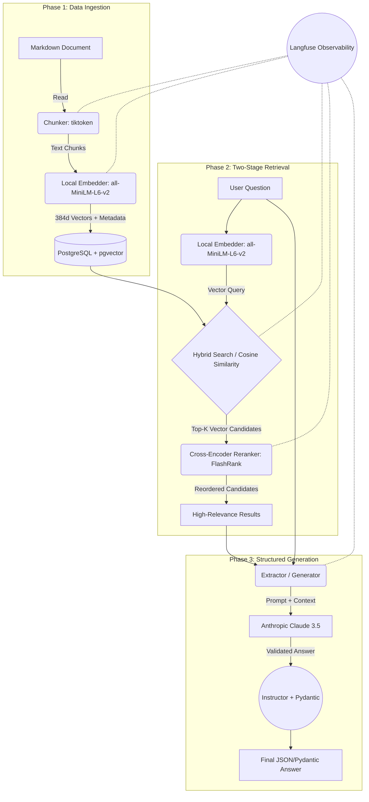

# RAG Pipeline Technical Architecture

This document describes the technical design, the data flow and the components implemented so far in the **AI Engineer Sandbox** project.

## Pipeline architecture diagram

The following diagram shows the full flow of information, from document ingestion to two-stage retrieval and the structured generation that follows.

---

## Technical components in detail

### 1. Data models (`src/models/`)
We use **Pydantic v2** to define strict contracts across the whole pipeline:
- `SearchResult`: the base structure of a candidate returned by PostgreSQL (ID, text, metadata, vector score).
- `RerankedResult`: inherits from `SearchResult`, adding the `rerank_score` produced by the cross-encoder.
- `StructuredAnswer` & `AnswerSource`: forced output models for the LLM. They make the AI provide a confidence score, cited sources and boolean flags (e.g. `requires_more_info`).

### 2. Ingestion (`src/services/ingestion.py`)
- **Text processing:** `tiktoken` (cl100k_base) is used deterministically for *chunking* into 256 tokens with a 30-token overlap. This suits small embedding models.
- **Vectorization:** uses `sentence-transformers` with the `all-MiniLM-L6-v2` model running locally on CPU/GPU to create 384-dimension dense embeddings. It needs no network and has no per-token cost.
- **Storage:** asynchronous connection through `asyncpg` to **PostgreSQL 16**. The vectors are stored in a `vector(384)` column provided by the `pgvector` extension.

### 3. Two-stage retrieval (Retriever + Reranker)
This is the quality core of the RAG system, designed to address the "Lost in the Middle" problem and the low semantic precision of a plain dot product:

- **Stage 1 - Vector retriever (`src/services/retriever.py`):** 
  Finds the Top-K (e.g. 5) most similar candidates in the database using `pgvector`'s native cosine distance/similarity (`1 - (embedding <=> query)`). It is very fast, but prone to retrieving documents that are semantically "close" yet wrong in context.
- **Stage 2 - Cross-encoder reranker (`src/services/reranker.py`):** 
  Uses `flashrank` with the `ms-marco-TinyBERT-L-2-v2` model. Unlike the retriever, which compares two vectors computed separately in advance (bi-encoder), the cross-encoder processes the [Question + Document] pair together through the Transformer's attention layers, working out whether the document *actually answers* the question. It returns the final Top-N (e.g. 3).

### 4. Structured extraction / generation (`src/services/extractor.py`)
- **Instructor integration:** patches the asynchronous `Anthropic` client to force Claude to output results validated against Pydantic's `StructuredAnswer` schema. If Claude gets the format wrong, `Instructor` *retries*, feeding back the validation error.
- **Delimited prompts:** the context coming from the re-ranker is injected clearly, explicitly referencing the database UUIDs to guarantee data lineage.

### 5. Cross-cutting observability (Langfuse)
Every main function is instrumented with `@observe(name="...")`. This allows tracing, on the Langfuse platform:
- The full execution tree (trace) of a request.
- Individual latencies of the retriever vs. the reranker vs. generation.
- The tokens sent to the generator.

### 6. Automatic evaluation system (evals)
The quality of the pipeline is checked with tests in `tests/test_rag.py` using the **DeepEval** framework and **pytest**. With an *LLM-as-a-judge* approach, two metrics vital for production RAG are tested:
- **Contextual Relevancy:** evaluates mathematically whether the documents retrieved by RRF and the reranker actually provide useful context.
- **Faithfulness:** heavily penalizes the generator for hallucinating any data that does not strictly exist in the retrieved sources.
