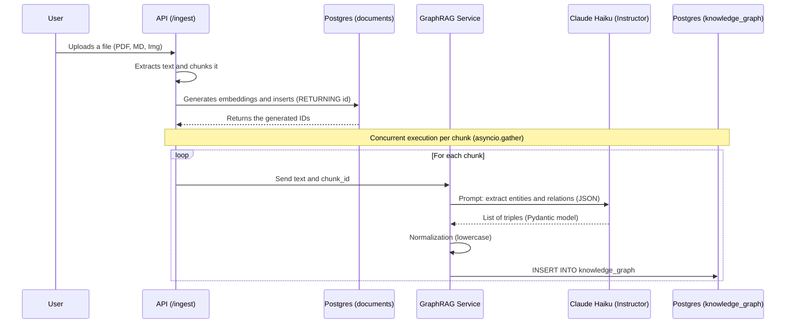
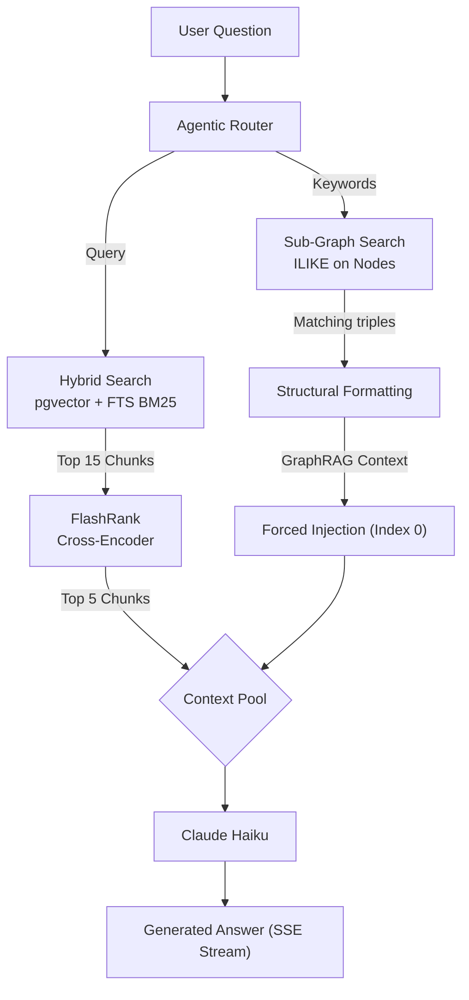

# GraphRAG Architecture Document

## Overview
A basic but very powerful **GraphRAG (knowledge graph RAG)** engine was implemented on top of PostgreSQL. Instead of a dedicated graph database such as Neo4j, we use Postgres's relational robustness to store triples (nodes and relations) linked by foreign keys to the vector chunks, running under the same multi-tenant security engine (RLS).

This strategy lets the LLM not only search for semantically similar text chunks (vector search) or keyword matches (BM25), but also receive explicit **structural context** about how the entities mentioned in the question relate to each other.

---

## 1. Database schema (PostgreSQL)

The `knowledge_graph` table was created to store the generated triples:

```sql
CREATE TABLE knowledge_graph (
    id UUID PRIMARY KEY DEFAULT gen_random_uuid(),
    tenant_id UUID NOT NULL DEFAULT '00000000-0000-0000-0000-000000000000',
    source_node VARCHAR(255) NOT NULL,
    relation VARCHAR(255) NOT NULL,
    target_node VARCHAR(255) NOT NULL,
    source_chunk_id UUID REFERENCES documents(id) ON DELETE CASCADE
);

-- B-tree indexes for very fast entity lookups
CREATE INDEX kg_source_idx ON knowledge_graph(source_node);
CREATE INDEX kg_target_idx ON knowledge_graph(target_node);

-- Security isolation (Row-Level Security)
ALTER TABLE knowledge_graph ENABLE ROW LEVEL SECURITY;
CREATE POLICY kg_tenant_isolation_policy ON knowledge_graph 
    USING (tenant_id = NULLIF(current_setting('app.current_tenant', TRUE), '')::UUID);
```

### Design decisions:
- **`source_chunk_id`**: traces the exact provenance of the triple back to the original text chunk (`documents.id`). It allows cascading deletes (`ON DELETE CASCADE`), so deleting a document automatically cleans up its graph.
- **Multi-tenancy**: like `documents`, the triples are invisible across tenants (users) through RLS.

---

## 2. Ingestion flow (LLM-as-a-Judge)

When a file enters the system, GraphRAG processing happens **asynchronously and in parallel** with vectorization.



### Key components (`src/services/graphrag.py`):
- We use `instructor` to force Claude to return a strict Pydantic schema:
```python
class Triplet(BaseModel):
    source_node: str
    relation: str
    target_node: str

class KnowledgeGraphExtraction(BaseModel):
    triplets: List[Triplet]
```

---

## 3. Retrieval flow (retrieval & generation)

When answering a query, GraphRAG steps in by injecting explicit relations before the answer is generated.



### Implementation details (`src/api/routers/chat.py` & `src/services/graphrag.py`):
1. **Simple node extraction**: to avoid the latency of a real-time LLM call, we extract tokens (keywords > 3 letters) straight from the user's query.
2. **Fuzzy search (ILIKE)**: we look in Postgres for any relation whose source or target node contains that keyword (e.g. if the question is about "Python", it looks for nodes containing `%python%`).
3. **Guaranteed injection**: the resulting text (`[Bryan] --(knows)--> [Python]`) **does NOT go through the reranker**. It skips the cross-encoder model and is force-injected at position `0` of the final result list:
```python
if graph_context:
    best_results.insert(0, SearchResult(
        id="graphrag-subgraph",
        content=graph_context,
        metadata={"source": "GraphRAG Local Database"},
        score=1.0
    ))
```
**Why?** Because BERT-based reranker models are trained to score natural prose. They tend to penalize highly structured, synthetic text (such as lists of triples), giving it a low score and discarding it. Injecting it *after* the reranker guarantees that the final LLM always reads it.

---

## 4. Files changed
* `sql/01_init.sql`: DDL table definitions (including `knowledge_graph`) and Row-Level Security. For an existing database, the equivalent migration is `sql/migrations/apply_graphrag.sql`.
* `src/services/graphrag.py`: holds the extraction (LLM) and retrieval (SQL) logic.
* `src/services/ingestion.py`: changed to return IDs after the insert and to orchestrate the asynchronous GraphRAG tasks with `asyncio.gather`.
* `src/api/routers/chat.py`: injection of the subgraph in the synchronous (`/chat/`) and asynchronous SSE (`/chat/stream/`) endpoints.
