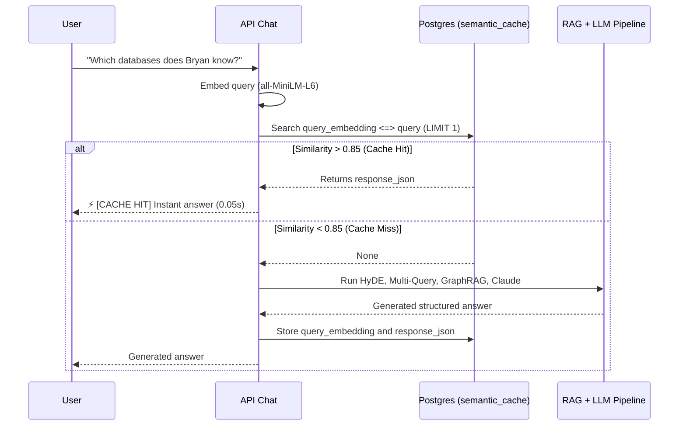
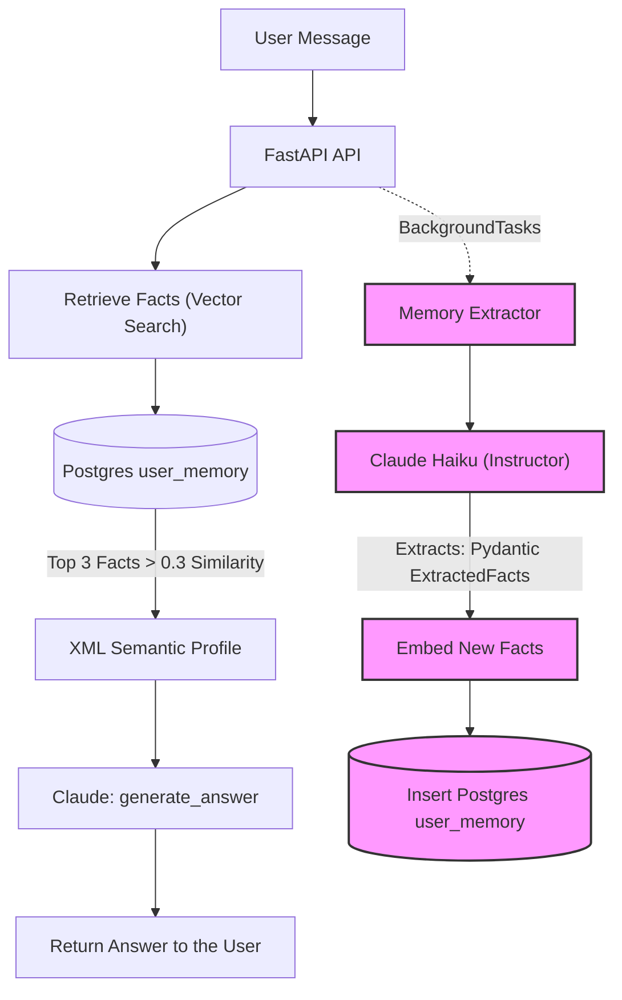
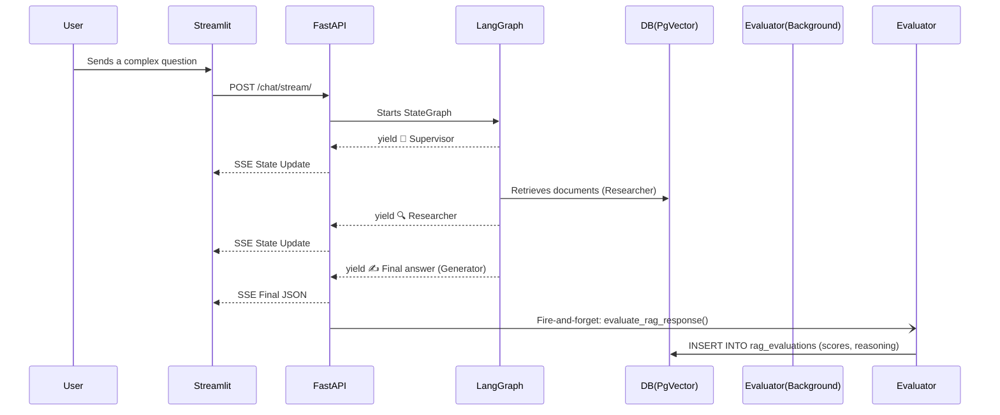

# Phase 4: Implementation details (expert level)

This document describes the architecture implemented for two of the most advanced components of the AI Engineer Sandbox: the **semantic cache** and **dynamic long-term memory**.

---

## 1. Semantic cache

### 📌 The problem
LLM inference (Claude) and generating vectors for retrieval (RAG) have a computational and financial cost. If users frequently ask identical or semantically very similar questions, running the whole pipeline again is a waste.

### ⚙️ Architecture implemented
A vector cache database was implemented in PostgreSQL (`semantic_cache`). Before processing a user's intent, the system embeds the question and looks for a match with `cosine_similarity > 0.85`.

### Design decision:
- **Similarity threshold (0.85):** for the local 384-dimension `all-MiniLM-L6-v2` model, wording variations (e.g. "What technologies does he use?" vs. "What does he use?") bring similarity down to ~0.88. A threshold of 0.85 proved to be the *sweet spot* between catching valid paraphrases and avoiding false positives.

---

## 2. Long-term memory

### 📌 The problem
Typical conversational systems suffer from "amnesia". They only remember the context of the current window (chat history). If the user clears the session or comes back another day, the agent forgets their preferences, name or work context. 

### ⚙️ Architecture implemented
A "background fact extraction" pattern was implemented. The system analyzes every message, extracts persistent entities/preferences, and stores them in the vector store (`user_memory`). Then, when a new question arrives, the bot injects the user's semantic profile before answering.

### Key components:
1. **Silent extraction (`extract_and_save_facts`):**
   Using `fastapi.BackgroundTasks`, the extraction analysis runs in a parallel thread that *does not block* the user's answer. If the call to Anthropic to extract the memory takes 1 second, the user never notices.
2. **Fact representation:**
   Claude is asked to standardize the memory in the third person (e.g. *"The user hates Java"*).
3. **Dynamic profile injection (`retrieve_user_facts`):**
   We do not inject **all** the memory on every turn, since it would pollute the context window over the years. We run a vector search between the **current question and the memory table** to bring only the 3 facts relevant to the ongoing conversation, wrapping them in a `<USER_PROFILE>` tag.

## Active observability (RAG evaluator)

An **LLM-as-a-judge** pattern inspired by **RAGAS/TruLens** was implemented. So as not to block the user or affect the application's latency, the evaluator runs as a FastAPI `BackgroundTask` once the answer has been sent to the client over SSE.

It feeds a structured model (through `instructor`) with the original question, the context retrieved by the agents, and the generated answer. 
The LLM assigns float scores (0.0 to 1.0) for three fundamental metrics:
1. **Faithfulness:** measures hallucinations. It penalizes an answer that mentions information absent from the context.
2. **Answer Relevance:** measures whether the answer directly addresses the user's intent.
3. **Context Precision:** measures the quality of the `retriever`, evaluating whether the injected context actually contained the useful information without "noise".

This data (together with a short chain of reasoning) is stored in the PostgreSQL `rag_evaluations` table, isolated per tenant under RLS policies.

### Execution flow (LangGraph + evaluator)

